# 3D 노선 — 병사를 3D 캐릭터로 (10-15 ~ 10-16)

> **왜:** 2D 컷아웃(스파인식) 굽기는 세트 · 레스트 · 복장 그림 · 장비 그림을 동작마다 맞춰 구워야 해서 리소스 관리가 감당이 안 됐다(사용자 결정 10-15: "2d 스파인 리소스 관리하는게 힘들어서 그냥 3d로").
> 그래서 **3D 캐릭터를 게임에 그대로 쓰고, 도트 느낌은 화면 단계(저해상도 렌더 · 계단 명암 · 1 도트 외곽선)에서 낸다.**
> 2D 화면(퍼펫)은 지우지 않았다 — 시험장에서 `--view=2d` 로 그대로 볼 수 있다. 성능 부하 시험은 사용자 지시로 이번에 하지 않았다(구색이 갖춰진 뒤 사용자가 직접).

## 바로 보기

- **`game/battle_test.tscn` F6** — 이제 기본이 3D. 키는 전과 같고 둘이 늘었다.

| 키 | |
|---|---|
| `F3` | 병사 그림 켬/끔 |
| `F4` | 복장 보기: 병종 복장 → **상의만** → **하의만** → 내복 (3D 슬롯이 도는지 바로 본다) |
| `F5` | 도트 크기: 도트 하나 = 화면 1 ~ 4 픽셀(1 = 도트화 끔) |

- 시험장 노드의 `use_3d` 를 끄거나 명령줄 `-- --view=2d` 면 예전 2D 퍼펫 화면.
- 도트 화면만 따로: **`test/dot_view_3d_demo.tscn` F6** — 사람 몸 여러 명 · 휠 확대 · `1`~`4` 도트 크기 · `O` 외곽선 · `I` 겹친 병사 사이 선 · `[` `]` 내려다보는 각 · `L` 명암.

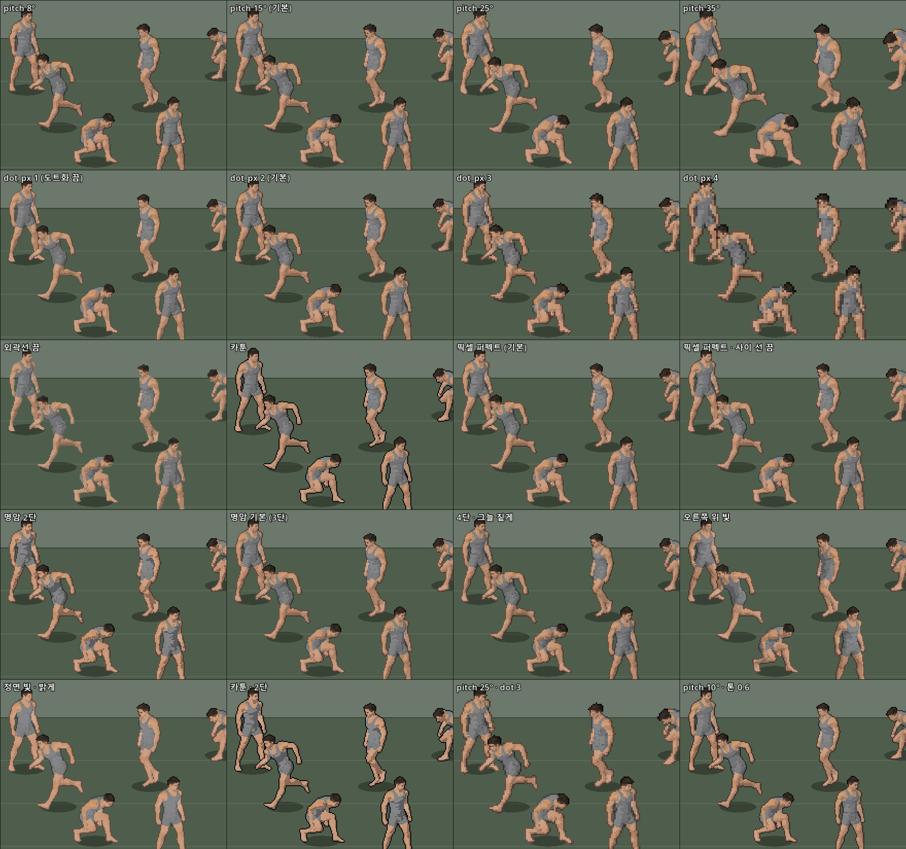

(내려다보는 각 · 도트 크기 · 외곽선 · 명암 비교. 기본 = 15° · 도트 2 px · 픽셀 퍼펙트 1 도트 · 3단 명암)

## 만드는 흐름 (사용자 몫)

| 무엇 | 하는 일 | 3D 에서 달라진 점 |
|---|---|---|
| **동작** | Mixamo FBX 를 `source3d/mixamo` 에 넣고(BoneMap 자동) → 동작 표 `game/units/rifleman_motions.tres` 에 이름 → 동작 표 화면(인스펙터 · ① 유닛 탭 오른쪽)의 **[3D 동작 내보내기]**(10-21 에 도구 메뉴 항목은 뺐다 — 늘 기본 표만 · 저장 안 한 고침을 안 읽어 헷갈림) | 세트 · 레스트 고르기 · 굽기 없음. 손 보정 · 비틀림 뼈 · 제자리 · 상하체 합성은 2D 와 같은 처리로 `game/motions/rifleman_anims.res` 한 파일에 들어간다 |
| **옷** | ③ 복장 탭: 옷 모델 붙이기(웨이트 원본 몸 = human_base) · 부위 칠하기 · 슬롯(상의 / 하의) → `outfit.json` | **굽기 없음** — 게임이 불러올 때 옷 모델을 슬롯 메시로 나눈다(처음 한 번 0.4 초, 그다음은 캐시) |
| **무기 · 헬멧** | ② 장비 탭: 유닛 씬의 뼈 소켓(오른손 · 머리 …)에 모델을 꽂고 자리 맞추기 · 무기 위 왼손 표지(아래 "② 장비 탭") | 무기 그림을 세트마다 굽지 않는다 — 3D 모델이 손뼈를 따라가고 왼손은 IK |
| **유닛(모습)** | **유닛 프리팹** = 루트가 `DRCharacter3D` 인 씬. 기본형 군인 `game/units/soldier_base.tscn` · 다른 유닛 = 그 씬을 상속한 자식 씬(아래 "유닛 프리팹") | 몸 · 상의 · 하의 · 동작 표 · 키가 씬 루트의 칸, 장비는 루트 아래 소켓 노드 |
| **병종(숫자)** | `rifleman.tres` — 능력치 · 무기 수치 · 판정 상자 + `prefab`(유닛 프리팹 하나) | 전투 계산은 병사 100명 넘게 노드 없이 도니까 숫자는 리소스에 |

### 유닛 프리팹 · ① 유닛 탭 (10-16)

사용자: "기본형 군인 부모 → 기관총사수 같은 걸 자식으로 둬서 관리" · "리소스 툴 1번 탭을 전체적으로 마이그레이션" · "예전 작업 목록(2D 캐릭터 굽기)은 남길 필요 없어".

| 유니티 | 여기 |
|---|---|
| 프리팹 + 컴포넌트 | 씬(.tscn) + 루트에 붙은 `DRCharacter3D` 스크립트(인스펙터 칸: 몸 · 상의 · 하의 · 동작 표 · 키 · 미리보기 동작) + 자식 소켓(장비) |
| 프리팹 변형(Variant) | **상속 씬** — 자식은 바꾼 칸 · 더한 노드만 파일에 남고 나머지는 부모를 따라간다(상의만 바꾼 자식 = 부모 상속 줄 + `outfit_top` 한 줄) |
| 뼈에 붙이기(소켓) | `BoneAttachment3D` — 유니티의 "손 뼈 아래 무기 오브젝트"와 같다 |
| ScriptableObject | 리소스(.tres) — 병종 숫자 · 동작 표 |

- **Dot Rigger 창 ① 유닛 탭**(예전 ① 2D 캐릭터 굽기는 지움): 왼쪽 = 유닛 목록(부모 → 자식 나무) · `+ 자식 유닛`(이름 적고 누르면 고른 유닛을 상속한 씬) · `씬 열기` · `저장` · 모습 칸(자식이면 칸마다 "부모 값 / 바꿈" + ↺ 부모 값으로) · **장비 요약**(소켓 → 장비, `② 탭` 단추 = 같은 유닛으로 ② 장비 탭) · `이 유닛만의 동작 표로 복사`. 가운데 = 3D 도트 미리보기(유닛을 통째로 묶은 사본 — 저장 안 한 고침 · 소켓 장비 · 왼손 IK 까지 게임과 같게 · 초당 12번 · 상태 골라 비중대로 틀기 · 다시 고르기 · 좌우 · 도트 크기). 오른쪽 = 그 유닛의 동작 표(인스펙터와 같은 화면).
- **탭과 인스펙터는 같은 것을 고친다**: 에디터에서는 유닛을 고르면 그 씬이 에디터에 열리고, 탭에서 칸을 바꾸면 그 씬 루트를 바꾼다(Ctrl+Z 되돌리기 · 씬에 * · `저장` = 씬 저장). 인스펙터에서 바꾼 것도 0.3 초 안에 탭에 반영된다. 씬을 열면 에디터 3D 화면에도 옷 입고 총 든 모습이 보인다(`미리보기 동작` 칸으로 자세 고르기).
- **세트**: 동작 표의 상태 묶음 — 기본 = 자세별 서기 · 앉기 · 엎드림(상태 54개를 한 번씩). 장비가 생기면 `+ 세트` 로 "설치 · 조작" 같은 묶음 · `+ 상태` 로 게임이 아직 모르는 상태 이름도 미리(⚠ 표시). 세트는 정리용이라 게임이 고를 때는 상태 이름만 본다.
- 자식 유닛이 동작을 따로 가지려면 `이 유닛만의 동작 표로 복사` → `<유닛>_motions.tres`(3D 동작 묶음 `game/motions/<유닛>_anims.res` 도 따로) → 그 표에서 `3D 동작 내보내기`.

### ② 장비 탭 — 뼈 소켓 (10-16)

사용자: "2번 탭이 레거시해 무기 피벗도 엉망" → "장비 3D 모델 하이어라키에 접근하여 맞추는 방식, 즉 3D 게임 방식의 정석으로. 나중에 헬멧도 모델링 head 에 꽂으면 되고."
예전 ② 장비 굽기(무기를 세트마다 2D 그림으로 · 3D 에서는 `DRGripFit` 가 동작마다 총을 두 손에 다시 돌려 맞춤 — 그래서 피벗이 튐)를 **유닛 씬 안의 노드**로 갈음:

```
기본형군인 (DRCharacter3D)
└ 오른손 (BoneAttachment3D · RightHand)        ← 소켓: 뼈를 따라감(몸은 안에서 조립 — 조립 뒤 DRCharacter3D 가 이어 줌)
   └ kar98k (무기 씬 인스턴스)                  ← 자리 · 회전 = 손뼈 기준 고정(기즈모 · 숫자 칸)
      └ 왼손 (DRHandTarget3D)                   ← 왼 손바닥 자리 · 손 회전 → 왼팔 두 마디 IK(내장 TwoBoneIK3D), 동작마다 비중
```

- 이 탭 · 씬 독 · 인스펙터 · 3D 화면 기즈모가 **같은 노드**를 고친다(에디터 = 열린 유닛 씬 · Ctrl+Z). 왼쪽 = 유닛 · 소켓 나무 · `+ 소켓`(뼈) · 모델 `넣기 · 바꾸기 · 빼기` · 자리(cm · °) · `지금 동작으로 무기 맞추기` · `지금 자세로 왼손 표지` · `저장` · `무기 기본 자리로 저장`(asset.json `socket_hold` — 다른 유닛 소켓에 넣을 때 처음 자리). 가운데 = 돌려 보기 / 도트 보기 · 동작 · 손 ↔ 표지 거리. 오른쪽 = 동작마다 왼손(IK 전 · 뒤 cm) · IK 비중.
- **미리보기 기즈모(유니티식, 10-16)** — 사용자: "기즈모 조작으로 인한 적용 기능도 부탁해. 단축키는 유니티 기즈모와 동일". 미리보기에서 장비 · 왼손 표지를 고르고 끌면 미리보기가 바로 따라오고(왼손 IK 도), **놓으면 유닛 씬의 그 노드에 되돌리기 한 칸**. 미리보기를 누르면(끌지 않고) 그 자리의 표지 · 소켓 · 장비를 고른다(빈 곳 = 풀기).

| 키 | | 키 | |
|---|---|---|---|
| `Q` | 보기(손잡이 없음 · 왼쪽 끌기 = 화면 옮기기) | `X` | 손잡이 방향 로컬 ↔ 글로벌(크기는 늘 로컬) |
| `W` | 이동 — 축 화살표 · 평면 네모 · 가운데 = 화면 평면 | `Z` | 기즈모 자리 피벗(원점) ↔ 중심(메시 가운데) |
| `E` | 회전 — 축 고리(따라 끈다) · 바깥 고리 = 화면 축 · 안쪽 = 자유 | `F` | 고른 것을 화면 가운데로 |
| `R` | 크기 — 축 끝 · 가운데 = 전체(왼손 표지 · 소켓은 없음) | `Ctrl`+끌기 | 눈금(도구 줄 칸: 1 cm · 15° · 0.1배) |
| `Y` | 변환 — 이동 + 회전 고리 + 가운데 = 전체 크기 | 끄는 중 오른쪽 · `Esc` | 취소 |
| `Ctrl+Z` · `Ctrl+Y` | 탭 창에서도 되돌리기 · 다시(① 탭도) | `Ctrl+S` | 유닛 씬 저장 |

  카메라: 휠 = 확대 · 가운데 끌기 = 옮기기 · 오른쪽 끌기 / Alt+왼쪽 끌기 = 돌려 보기 · Alt+오른쪽 끌기 = 확대(빈 곳 왼쪽 끌기 = 돌려 보기도 그대로). 카메라를 거의 똑바로 보는 축은 유니티처럼 숨긴다(끌면 조금만 움직여도 멀리 튐). 숫자 칸에 `크기` 줄도 생김. 끄는 동안은 동작을 멈춘다(손이 움직이면 놓은 자리가 손 기준으로 어긋나므로). 코드 = `ui/transform_gizmo.gd`(class_name 없이 preload — "개발 내용 갱신"으로 바뀜).
- **잡기 — 고정할 곳(10-16 확장)** — 사용자: "오른손 · 왼손 · 양손 — 조인트 느낌, 어느 부분(소켓)을 고정할지 … mp40 이나 라페테에 얹어 양손으로 잡는 mg42 이면? … 무기를 기즈모로 움직이면 오른손도 따라가거나 양손이거나". ② 탭 왼쪽 `잡기` 단추 넷 — 지금 미리보기에 보이는 자리 그대로 받침만 바꾸고(유니티 "자리 유지하며 부모 바꾸기"), 따라갈 손의 표지가 없으면 그 손의 지금 자리로 만든다(되돌리기 한 칸):

| 잡기 | 무기가 고정되는 곳(받침) | 따라가는 손(IK) | 쓰임 |
|---|---|---|---|
| 오른손 | 오른손 소켓(BoneAttachment3D) | 왼손 | 소총 · kar98k(기본형 군인) |
| 왼손 | 왼손 소켓 | 오른손 | 왼손으로 드는 장비 |
| 양손 | **받침대 `DRGripMount3D`(두 손 사이)** — 오른손 쪽 자리 ↔ 왼손 쪽 자리를 `보간`(0 % 오른손 ~ 100 % 왼손)으로 | 두 손 | mp40 처럼 두 손으로 드는 무기 — 무기가 동작의 두 손을 따라 움직이고 두 손이 손잡이에 붙음 |
| 고정 | 받침대(유닛 · 땅 기준 고정) — 기즈모로 옮김 | 두 손 | 라페테(삼각대) 위 MG42 · 거치 무기 |

  - 손 표지가 두 종류: `DRHandTarget3D.side` = 왼손 · 오른손(예전 표지 = 왼손). 받침이 그 손이면 그 손 표지는 쉰다(나무에 회색 — 무기가 그 손을 따라가므로 IK 를 걸면 서로 따라가는 순환).
  - 양손 받침대는 그 동작에서 **총을 잡은 손만** 따른다(손 IK 비중으로 — 수류탄처럼 한 손을 놓으면 남은 손 쪽으로). 계산은 뼈대 수정자 차례 **맨 앞**의 풀이 수정자(`runtime/dr_grip_solver_3d.gd`)가 동작 자세(IK 전)로 — 손이 IK 로 움직인 자리를 받침대가 다시 따라가는 순환이 없고, 동작 재생 · 되감기 · 에디터 누가 자세를 바꿔도 같은 차례.
  - 오른쪽 동작 표는 `왼손 / 오른손` 을 골라 그 손의 동작별 IK 비중 · 수치를 본다. 정보 줄 = 손마다(무기를 듦 / 표지를 따라감 cm / 동작 그대로).
  - 검사(창 없이 · 메모리 인스턴스): 네 방식 모두 바꿔도 무기 자리 0.0 mm · 따라가는 손 IK 뒤 0.00 cm · 양손 걷기에서 무기가 두 손을 따라 4.1 cm · 보간 100 % 오른손 = 오른손 쪽 자리 · 기즈모로 옮기면 두 손 다 따라감 · 고정은 동작이 바뀌어도 0.00 mm · 게임 길(MANUAL) 두 손 IK 0.00 cm. 에디터 안: 양손 → 탭 창 Ctrl+Z 로 원래 소켓 · 주인 그대로(받침대 · 새 표지 빠짐) → Ctrl+Y.
  - 아직: MG42 모델이 없어 kar98k 로 시험했다. 라페테처럼 땅에 놓인 장비에 맞는 사수 동작(엎드려 · 앉아 쏘기 — 손이 닿는 자리)은 동작 표에서. 동작마다 받침 방식을 바꾸는 것(예: 장전만 오른손)은 아직 없음 — 지금은 손 IK 비중 · 아래 동작별 무기 자리로.
- **동작별 무기 자리(10-19)** — 사용자: "2번 탭은 애니메이션별로 양손이든 왼손이든 오른손이든 총기 위치 회전 오프셋을 지정해 둘 수 있는 리소스 툴인 거지?" → "2번 작업도 시행. ui / ux 잘 신경 써 줘".
  무기 자리 = **기본 자리(장비 노드의 transform) × 그 동작의 차이**(장비 메타 `dr_motion_offsets` = {동작: 위치 · 회전}, 유닛 씬에 저장 · 잡기 방식 넷 모두). 차이는 무기 자신의 축 기준이라 잡기(받침)를 바꿔도 뜻이 같다.

| 어디서 | 하는 일 |
|---|---|
| 미리보기 위 도구 줄 `무기 자리: [모든 동작] [이 동작만]` | **이 동작만**이면 기즈모 · 숫자 칸이 지금 동작의 자리만 고친다(위치 · 회전만 — 크기 손잡이는 숨김). 단추가 주황으로 바뀌고 미리보기 위에 주황 띠 `✎ Firing_Rifle — 차이 3.4 cm · 5°` + `[맞추기] [기본으로] [끝]` |
| 띠의 `맞추기` | 지금 동작 · 시점의 손(동작 그대로)에 무기 표지가 오게 자동으로 — 손 소켓 무기 = 든 손을 축으로 돌림(쥔 손에서 안 미끄러짐), 양손 = 두 표지의 가운데 · 방향을 두 손바닥에. 고정(땅) 받침대는 없음 |
| 오른쪽 동작 표 `무기 자리` 칸 | `● 3.4 cm · 5°` 따로 둠(주황) · `↳ Firing_Rifle` 상하체 합성은 상체 동작 것(파랑) · `기본`. 행 **두 번 누름 = 이 동작만 고치기** · **오른쪽 누름 = 이 동작만 고치기 · 맞추기 · 복사 · 붙여넣기 · 기본 자리로** |
| 모든 동작 모드 | 지금 동작에 차이가 있으면 미리보기 = 기본 + 차이 — 기즈모로 옮기면 **기본 자리만** 바뀌고 차이는 그대로(숫자 칸 아래 주황 안내 줄) |
| 그 밖 | 나무의 장비 줄 `· 동작별 자리 N` · 정보 줄 `무기 = 이 동작 자리(…)` · ① 탭 장비 요약 · `무기 기본 자리로 저장`(asset.json `socket_hold.motion_offsets` — 다른 유닛에 넣을 때도) · 되돌리기 한 칸(Ctrl+Z / Ctrl+Y) |

  - 게임: 동작이 바뀌면 손 IK 비중과 **같은 섞는 시간** 동안 무기도 옮긴다(`DRCharacter3D.play_motion` → `step_motion`, 손 IK 목표도 따라감). 편집 중인 씬에는 안 얹는다(얹으면 그 값이 기본 자리로 저장되므로) — 미리보기 · 게임 사본만.
  - 사용자가 저장한 양손 씬(10-16 19:06)에서 `맞추기`: Firing_Rifle 왼팔 IK 뒤 6.7 → 0.0 cm(차이 6.3 cm · 28°) · Walk_With_Rifle 5.0 → 0.0 cm(8.3 cm · 16°) — 아래 "남은 것" 의 한 자세 기준 문제가 이걸로 풀린다(사용자가 탭에서 눌러 저장해야 씬에 남음).
  - 코드: `runtime/dr_character_3d.gd` "동작별 무기 자리" 절(`motion_offsets` · `offset_key` · `offset_for` · `set_equip_base` · `sync_from` — ① ② 미리보기 동기화도 이 하나로) · `ui/equip_page.gd` "동작별 무기 자리" 절.

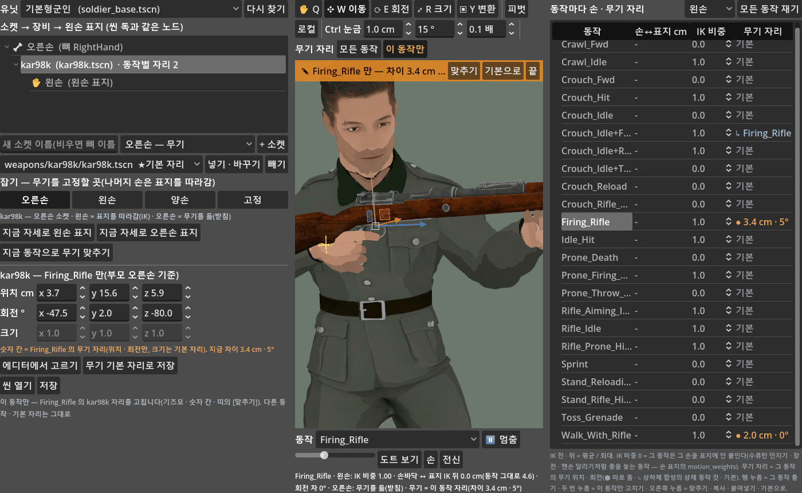

(이 동작만: 도구 줄 단추 주황 · 미리보기 위 띠 `✎ Firing_Rifle — 차이 3.4 cm · 5°` · 숫자 칸 = 그 동작 자리(크기 잠김) · 오른쪽 표 `무기 자리` 칸 — ● 따로 · ↳ 상체 것 · 기본. 탭 기본 크기 1400 × 860)
- 왼손이 총을 놓는 동작(수류탄 · 장전 · 맨손 달리기 · 피격 일부)은 비중 0. 동작이 바뀌면 섞는 시간(0.1 초) 동안 비중도 옮긴다. 게임은 뼈대 수정자를 자세가 바뀔 때만(초당 12번) 돌린다.
- 자식 유닛은 부모 장비를 지울 수 없어 숨기고 새 장비를 넣는다(게임에서는 숨긴 장비를 지움). 머리 소켓 + 대용 헬멧으로 시험함(진짜 헬멧 모델은 아직 없음).
- ① 유닛 탭 미리보기 · ③ 복장 탭 `무기` 도 같은 소켓 장비를 쓴다(③ 은 기본형 군인의 소켓을 빌려 꽂음).

| 동작(kar98k) | 왼 손바닥 ↔ 표지 IK 뒤(IK 없으면) cm |
|---|---|
| Rifle_Aiming_Idle · Firing_Rifle | 0.0 (0.2 · 0.6) |
| Rifle_Idle · Walk_With_Rifle | 0.0 (19.8 · 12.9) |
| Crouch 사격 · 조준 · Prone_Firing_Rifle | 0.0 (… · 6.6) |
| Idle_Hit(IK 켬) | 8.3 — 팔이 안 닿는 순간 |

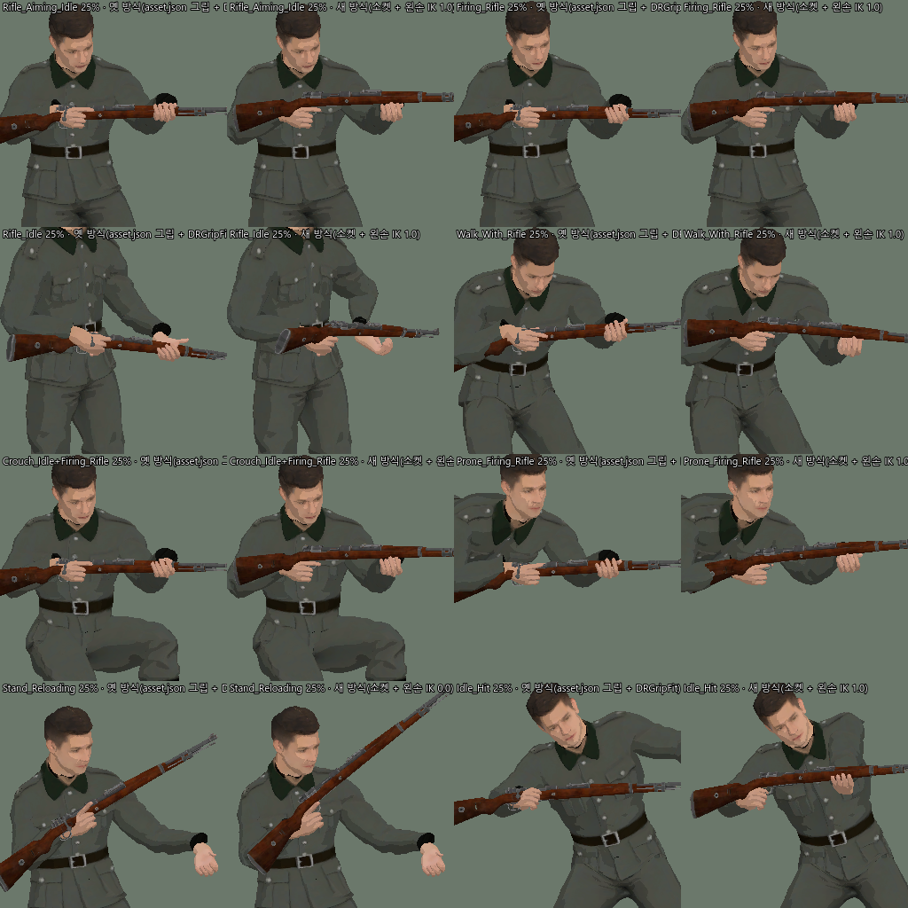

(동작마다 왼쪽 = 옛 방식(asset.json 그립 + 동작마다 다시 맞춤) · 오른쪽 = 소켓 + 왼손 IK. Stand_Reloading 은 IK 0 — 장전 동작이 AR 탄창 교체라 kar98k 와 안 맞음)

### 조준 IK — 사격 때 팔(견착) · 허리로 총구 높낮이를 표적에 (10-21)

사용자: "사격을 할 때 적의 위치 · 적을 바라보는 벡터 기준으로 허리가 살짝 굽거나 해야 될 것 같아 — 총구가 적을 바라봐야 되니까. 이런 건 IK 기술의 파생인가?"
→ 네(조준 IK · 에임 오프셋). 동작을 더 받지 않고 **동작 위에 덧씌운다**: 그 동작의 총구 높낮이를 표적 높이로 한계 안에서 들고 내린다 — 팔(견착점 축)이 주로, 나머지는 허리 · 가슴.
**좌우는 안 돈다**(사용자 10-21 "옆(좌우)은 필요 없는 것 같아 — 결국 횡스크롤 게임에 리소스를 3D 만 사용하는 거라" — 처음 판은 앞뒤 줄 표적으로 몸을 옆으로도 돌렸다).
조준 수정자는 뼈대 수정자 차례 맨 앞(받침대 풀이 · 손 IK 보다 먼저).

| 정한 것 | 왜 |
|---|---|
| **높낮이는 팔이 주로(팔 몫 기본 70 %) — 견착점(개머리판 끝) 축으로 총을 들고 내리고 두 손이 IK 로 따라감**, 나머지 30 % 는 허리 · 가슴(Spine 30 % · Chest 35 % · UpperChest 35 %) · 머리는 팔 몫의 60 % 를 따라 숙이고 듦 | 사용자(10-21 저녁): "허리가 들리는 것도 있지만 진짜 조준을 할 때 팔 부분이 영향이 제일 많이 가잖아 — 양팔로 인한 견착 위치에 따라". 허리만이면 위 25° 에 몸이 뒤로 20° 젖혀졌다 → 팔 70 % 면 가슴 6° · 견착점 2.3 cm 이동, 100 % 면 가슴 0° · 견착점 제자리. 손 소켓 무기 = 든 손을 그 팔 두 마디 IK(`DR_Aim<손>ArmIK`)로 돌린 자리에, 두 손 사이 받침대 = 받침대를 견착점 축으로 돌림. 견착점 = 무기 아래 `견착` 노드, 없으면 −Z 쪽 메시 끝의 가운데(kar98k 개머리판 — 원점보다 3 cm 아래) |
| **기준 = 그 동작의 총구 방향 평균**(동작 그대로 8 시점 — 동작 파일에서 바로 계산 · 캐시) | 매 장면 총구를 표적에 붙이면 동작의 반동 · 흔들림이 지워진다. 평균에서 돌리면 흔들림 그대로(0.49° → 0.48°) |
| **총구 높낮이 = 총구에서 본 표적 높낮이**(정확히 — 표적은 쏘는 병사 줄로 두고 좌우 거리 대 높이 차, Ballistics 와 같은 뜻) | 높은 벽 위 · 참호 아래 · 엎드린 적 — 화면에서 바로 보이는 것 |
| **총구 = 무기 +Z 앞 끝의 총열 축**(메시에서 잼 — 앞 끝 바로 뒤 토막의 가운데, 맨 끝은 가늠쇠가 솟아 빼고) · 무기 아래 `총구` 노드가 있으면 그것 | 첫 판은 원점(방아쇠) 높이로 잡아 kar98k 총구 선이 총열보다 4.5 cm 아래에서 나갔다(사용자 "조준선과 총구가 안 맞네? 위치가") |
| `위로 최대` 30° · `아래로 최대` 30°(동작이 원래 겨눈 높이에서 더 드는 최대 각) · `빠르기` 240°/s · `팔 몫` 70 %(유닛 루트 칸) | 40° 면 몸이 뒤로 크게 젖혀진다(아래 그림 오른쪽 끝 = 30° 에서 멈춤). 표적이 바뀌면 초당 240° 로 따라감, 나타나고 사라질 때 0.15 초 섞음 |
| 동작마다 조준 비중(0 ~ 1) — **기본 = 동작 표의 "사격" · "조준" 상태에 든 동작이면 1, 아니면 0** | 서기 · 걷기 · 장전 · 수류탄 · 달리기는 안 돈다. 상하체 합성 `A+B` 는 제 것이 없으면 상체 B 것. 동작이 바뀌면 손 IK 와 같은 섞는 시간(0.1 초) 동안 비중도 옮긴다 |
| 고정 받침대(땅 — MG42 라페테)에 든 무기는 몸으로 안 겨눔 | 거치 무기는 장비를 돌려야 한다(나중) |
| 게임 표적 = `Ballistics.aim_point`(두뇌가 고른 적의 겨눌 곳 — 총알이 가는 곳과 같다) · 조종 중이면 마우스 조준점 | 동작 박자(초당 12번)에 넣는다 · 화면 밖 병사 · 쓰러진 병사는 안 함 |

| ② 장비 탭 | 하는 일 |
|---|---|
| 왼쪽 `☑ 조준` + 설명 4줄 + `위로 최대 ° · 아래로 최대 ° · 빠르기 °/s · 팔 몫 %` | 유닛 루트 칸(인스펙터 "조준" 묶음과 같은 값 · 칸마다 풍선 도움말). 끄면 표 칸 · 숫자 칸이 잠긴다. 되돌리기 한 칸. (10-21 사용자 "설명이 필요한 것 같아 — 위 한계는 이해가 가는데 각도 한계잖아?" → 이름을 무엇을 바꾸는지 그대로 · 설명 줄) |
| 가운데 `[조준 미리보기]` · `표적 높이` 끌기 | 미리보기 병사가 그 높이를 겨눈다(단추 분홍) — 표적 = 분홍 십자, 총구 선 = 초록(표적으로) · 주황(한계에서 멈춤), 견착점 = 노란 십자. 켜면 몸 · 표적이 다 보이게 카메라를 맞춘다. 꺼진 채 끌어도 켜진다. 정보 줄 `조준 100 % · 총구를 +15° 듦(팔 +11° · 허리 · 가슴 +5°) — 동작이 원래 겨눈 높이 +5°` |
| 조준 비중 0 인 동작에서 켤 때 | 조준하는 동작(Firing_Rifle 우선)으로 바꾸고 상태 줄에 알림 · 미리보기 중 비중 0 동작을 고르면 막대 바로 옆에 주황 `⚠ 이 동작은 조준 0 %`. (10-21 사용자 "토글 누르고 막 끌었는데 변화 없는데?" — 사용자 동작 표에서 `서기+조준` 을 지워 처음 트는 Rifle_Aiming_Idle 이 0 이었다) |
| 왼쪽 `[총구 표지]` · `[견착 표지]` · `[자동으로]` | 무기 아래 `총구` · `견착` Marker3D 를 만들고(처음 자리 = 메시에서 잰 자리) 고른다 → **기즈모로 옮김**(총구 = W 이동 · E 회전, 파란 축 = 레이 방향 · 견착 = W 이동). 끄는 동안에도 레이 · 견착점이 따라오고, 표지를 고르면 미리보기를 안 켜도 하늘색 레이 · 노란 견착점이 보인다. 나무에 `🎯 총구` · `📍 견착` 줄 · 미리보기에서 눌러 고르기 · 숫자 칸 · 되돌리기 한 칸 · 유닛 씬에 저장 · `무기 기본 자리로 저장` 이면 asset.json `socket_hold.aim_markers` 에도(다른 유닛에 넣을 때 따라감). `자동으로` = 표지를 지워 메시에서 다시 잼. (10-21 사용자 "조준선과 총구 위치(즉 레이 기능) — 그 위치를 조정할 수 있는 기즈모 기능 연동도 필요해") |
| 오른쪽 동작 표 `조준` 칸 | 그 동작의 조준 비중(흐림 = 기본 · 파랑 = 합성의 상체 것). 기본과 같은 값으로 고치면 따로 값을 지운다 · 오른쪽 누름 `조준 미리보기(이 동작)` · `조준 비중 기본으로` |

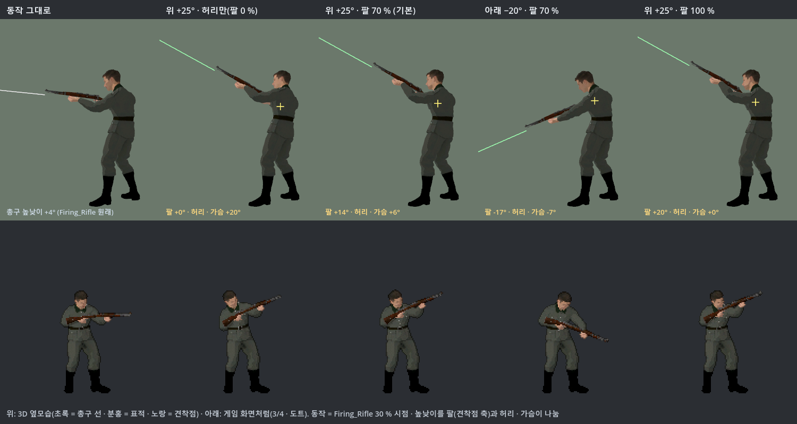

(Firing_Rifle 30 % 시점. 위 = 3D 옆모습(노랑 = 견착점) · 아래 = 게임 화면처럼(3/4 · 도트). 왼쪽부터 동작 그대로(총구 +4°) · 위 +25° 허리만(팔 0 % — 몸이 뒤로 20° 젖혀짐) ·
위 +25° 팔 70 %(기본 — 팔 +14° · 허리 · 가슴 +6°) · 아래 −20° 팔 70 % · 위 +25° 팔 100 %(가슴 그대로 · 견착점 제자리))

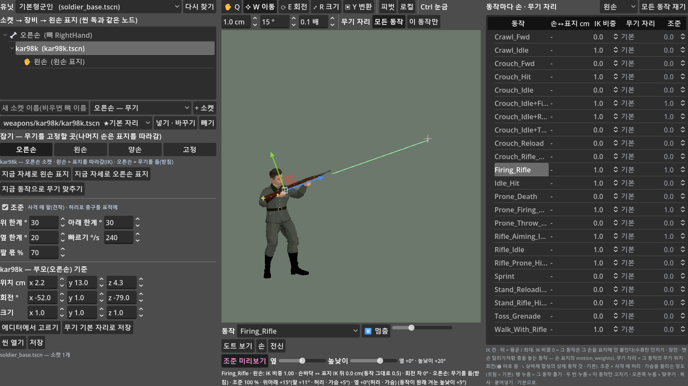

(왼쪽 조준 칸(설명 · 위로 · 아래로 최대 · 빠르기 · 팔 몫) · 가운데 조준 미리보기(표적 높이 +20° — 분홍 십자 · 총열 끝에서 나가는 초록 총구 선 · 노란 견착점) · 오른쪽 표 맨 끝 `조준` 칸. 1600 × 900)

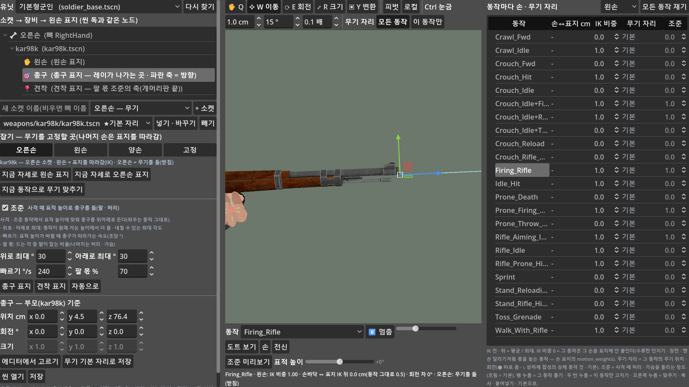

(`[총구 표지]` 를 눌러 고른 모습 — 나무 `🎯 총구` · `📍 견착` · 총열 끝의 기즈모 · 하늘색 레이(미리보기 꺼짐) · 숫자 칸 = 무기 기준 0 · 4.5 · 76.4 cm)

- 측정(`tools/aim_check_cli.gd` 35항목): 정면 · 위 25° · 아래 20° · 옆으로 벗어난 표적 — 총구 높낮이 ↔ 표적 0.1° 안 · 좌우 방향 그대로(0.03° 안) · 총구 = 총열 축(원점 +4.5 cm) · 견착점 = 개머리판 끝 가운데(−3.0 cm) · 한 바퀴 평균 실제 총구 높낮이 24.7°(표적 25.1°, 조준 전 5.1°) · 위 25° 조준 중 왼손 IK 뒤 0.00 cm · 앉아 사격(합성) · 엎드려 사격 · 캐릭터를 돌리고 키를 바꿔도 같음 · 양손 받침대도(두 손 IK 가 조준 전보다 나빠지지 않음 · 받침대를 견착점 축으로 돌려 실제 총구 24.1° — 사용자 양손 씬 사본).
  팔 · 견착(위 25°): 팔 몫 0 / 70 / 100 % → 가슴 뼈 돌림 20.0 / 6.0 / 0.0° · 견착점 이동 6.7 / 2.1 / 0.0 cm · 실제 총구 24.2° · 왼손 0.00 cm · 총구 끝 35 cm 올라감 · 거두면 팔 IK 꺼짐.
- 게임(`view3d_smoke` 20 초 더 · 화면을 줄여 전장 전체): 사격 · 조준 동작 병사 · 프레임 2,084 중 99 % 에 표적 · 1 초마다 잰 34번 중 다 돈 33번 겨눌 방향과 최대 0.00° · 위아래 돌림 최대 6.8°(같은 높이 적이면 몇 도뿐 — 높이 차가 클 때 크게 보인다) · 한계 걸림 0(옆 조준이 있던 판은 8번 — 모두 앞뒤 줄 차이).
- 코드: `runtime/dr_character_3d.gd` "조준 IK" 절(`set_aim_target` · `set_aim_elevation` · `aim_weight_for` · `aim_report` · `_solve_aim` · `aim_muzzle_at` · `_aim_ref` 동작 파일 FK · `find_muzzle` · `_measure_weapon`(총열 축 · 개머리판, 무기마다 한 번) · 팔 IK `_make_aim` · 받침대 팔 몫 `_solve_mounts` · `shoulder_world`) · `runtime/dr_aim_solver_3d.gd`(수정자) · `game/view/battle_view_3d.gd` `_aim` · `ui/equip_page.gd` "조준 IK" 절.
- 수정자 차례(손 소켓 무기): `DR_AimSolver` → `DR_AimRightElbow` · `DR_AimRightArmIK` · `DR_AimRightHandRot`(조준 팔 — 팔 몫이 없으면 꺼짐) → `DR_LeftRef` …(왼손 표지 IK — 돌린 오른손을 따라감).

### ③ 복장 탭 (10-16)

예전 ③ 복장 굽기(옷을 세트마다 2D 그림으로 굽던 것)를 **3D 복장 탭**(`ui/outfit_page.gd`)으로 갈음 — 게임은 옷 모델을 슬롯 메시로 나눠 바로 입히므로 굽기가 없다. 이 탭이 고치는 것 = 옷 모델 · `<모델>.parts.json`(부위 경계 · 칠하기) · `outfit.json` 슬롯 표.
- 왼쪽: 1 복장 · 옷 모델 · 기본 몸 → 불러오기 · 2 옷 모델 새로 만들기(AI 원본 → 뼈대에 붙이기, Blender — "팔 · 소매 끝 맞춤" 기본 켬) · 3 부위 경계(관절 평면 — 끌면 바로 저장 · 다시 자르기) · 4 직선 · 사각형 · 붓 · 5 슬롯(상의 · 하의 · 기본 몸) · [저장].
- 가운데: 3D 부위 칠하기(T-포즈, 면마다 잘리는 부위 색). 오른쪽: **3D 도트 미리보기**(게임과 같은 처리) — 차림 4가지(전체 / 상의만 / 하의만 / 내복) · 동작 · **이음매 확대**(목 · 왼 손목 · 오른 손목 · 허리) · 뚜껑 켜고 끄기 · 무기.
- 군복 손목 꺾임은 소매가 손목과 어긋나 있던 것 — 붙이기 공정에서 고쳐 군복을 다시 만듦(02 U36):

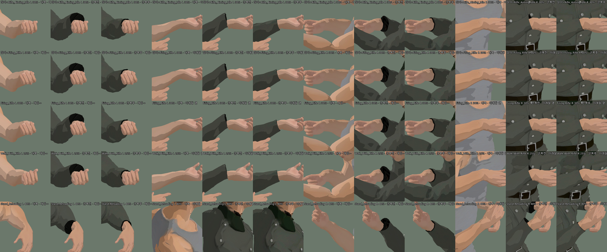

(동작마다 손목 한 줄 = 내복 / 군복 전 / 군복 후 — 전에는 손목에 검은 원판이 튀어나와 꺾여 보임)

### 도트 느낌 설정 (10-16)

사용자: "예전에 픽셀 퍼펙트 기능 같은 게 사라져 있네?" → 예전 ① 탭(2D 굽기)의 도트화 · 외곽선 칸을 **`game/dot_style.tres`(DRDotStyle)** 하나로 옮겼다. 게임 화면(BattleView3D)과 ① 유닛 탭 미리보기가 같은 파일을 읽는다.
- ① 유닛 탭 미리보기 아래 **"도트 느낌"** 을 펼쳐 고친다: 외곽선(없음 / 1 도트) · 선 방식(카툰 / **픽셀 퍼펙트**) · 선 색 · 톤 · 겹친 캐릭터 사이 선 · 각도 · 초당 장수(12 = 예전 2D 의 끊는 맛) · 명암 단계 · 어두운 면 · 빛 감싸기 · 가장자리 빛 · 옷 속 밝기 · **명암 매끈함**(cm, 10-16 저녁) · 빛 방향 → 미리보기에 바로, `도트 느낌 저장` 하면 게임도. 인스펙터로 `game/dot_style.tres` 를 열어 고쳐도 같다.
- 외곽선 두께는 지금 1 도트까지(도트 2 px 면 화면 2 px — 예전 2D 의 2 px 선과 같은 굵기).

### 도트가 지저분하고 머리 꼭대기가 비어 보이던 것 (10-16 저녁)

사용자: "1번 탭이든 3번 탭이든 짜글짜글해지고 머리가 비어 보여. 도트 영역이 지저분하달까?" — 원인은 셋이었다(도트마다 읽은 UV · 밉맵 단계를 찍어 추적, 02 U41).

| 원인 | 보이던 것 | 고침 |
|---|---|---|
| 텍스처를 **반복(repeat)** 으로 읽음 | 사람 몸은 머리 꼭대기가 텍스처 맨 아래 줄 — 작게 그리면(밉맵 4 ~ 8 단계) 맨 위 줄의 피부 · 회색이 감겨 들어와 정수리에 밝은 도트 = **비어 보임** | `dot_char.gdshader` 반복 끔(모델 UV 는 전부 0 ~ 1) |
| 비스듬한 면의 밉맵을 **긴 축**으로 고름 | 머리 윗면 · 어깨 · 실루엣 가장자리가 256 텍셀 네모 평균(남의 UV 조각 색) → 주황 · 피부색 점, 팔 위 주황 줄 | 비등방 필터(짧은 축으로 단계, 긴 축을 따라 여러 번 읽음) |
| AI 메시 주름마다 **명암 단계가 잘게 끊김** | 몸 · 얼굴이 얼룩덜룩, 움직이면 반짝임(짜글짜글) | 메시를 나눌 때 노멀을 고르게 폄 — 도트 느낌 `명암 매끈함`(기본 6 cm, 0 = 끔). 처음 조립 때 모델당 +60 ~ 80 ms, 목 · 손목 경계 노멀도 같아짐(28° → 0.07°) |

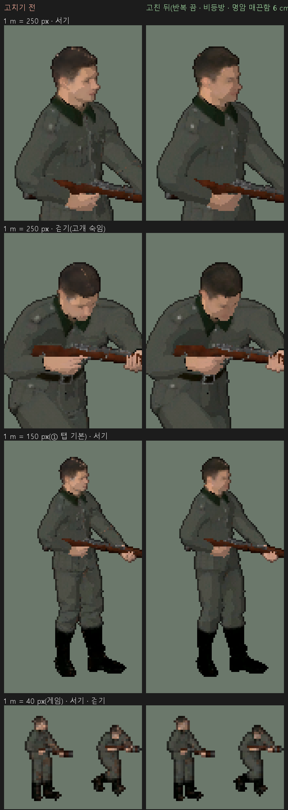

(왼쪽 고치기 전 · 오른쪽 고친 뒤. 위에서부터 1 m = 250 px 서기 · 걷기(고개 숙임) · 150 px(① 탭 기본) · 40 px(게임))

- 해 봤지만 안 쓴 것: 밉맵 치우침 +1 · +2(더 번짐) · 밉맵 상한 2(번짐은 없어지나 지글거림이 늘어남) · 텍스처 틈 다시 채우기(`pipeline/fill_uv_gaps.py` — Tripo 는 틈이 이미 이웃 색으로 번져 있어 효과가 작았다, 시험용으로 남김).
- `명암 매끈함` 은 맛의 문제 — 크게 하면 큰 덩어리 명암(얼굴 입체감도 준다). 바꾸면 ① 미리보기는 바로 다시 조립되고, ② ③ 미리보기는 다음 조립 때부터 바뀐다.

### 정수리 살색("탈모 형태") — 맞닿은 UV 조각 (10-19)

사용자: "머리가 그래도 비어 보이긴 하는데…" → (증상 확인) "탈모 형태로 x2 도트화부터 머리 빈 곳이 보임. 살색이 비쳐짐 정수리 부분이나." 위 10-16 고침 뒤에도 남은 것(02 U42).

| 원인 | 보이던 것 | 고침 |
|---|---|---|
| 머리카락 조각 A 의 끝(정수리 앞 가운데 이음매, UV x 1800 ~ 1823)이 아틀라스에서 **피부 조각과 몇 텍셀 사이로 붙어** 있음 — 텍스처 내용은 정상(정수리 전부 머리색) | 도트 2 px 이상에서 정수리에 살색 도트 — 밉맵 4 ~ 5 단계부터 옆 조각이 섞임(정수리 밝은 도트: 도트 1 = 0.16 % · 2 = 0.85 % · 3 = 1.8 % · 4 = 3.85 %, 1 m = 40 px 에선 머리 도트의 30 ~ 100 %) | **안전 밉 지도** — `pipeline/safe_mip_map.py` 가 텍셀마다 "남의 조각 · 틈까지 거리로 정한, 읽어도 되는 발자국 길이"를 텍스처 옆 `<이름>.safemip.png`(512², 무손실)로 굽고, `dot_char` 가 발자국이 그보다 길 때만 기울기를 줄여 읽는다(조각 경계 근처만 또렷 · 안쪽은 밉맵 · 비등방 그대로). 정수리 밝은 도트 도트 2 · 3 · 4 = 21 · 20 · 24 → 0 |

- **10-21 사용자 확인: "정수리가 안 비어 보여"**(에디터 재시작 뒤). 같은 날 ② 동작별 무기 자리도 "얼추 총을 잘 잡고 애니메이션도 이상한 티가 적다".
- 걱정했던 지글거림은 오히려 줄었다(번진 남의 색이 움직일 때 반짝임이었다): 1 m = 40 px 도트 2 — 다음 장과 바뀐 도트 32.5 → 28.8 % · 이웃과 색이 다른 쌍 56.7 → 50.3 %. 40 px 에서 군복 · 머리의 갈색 · 주황 번짐도 사라짐.
- 틈 다시 칠하기(`fill_uv_gaps.py`)로는 0.85 → 0.65 % 뿐 — 맞닿은 조각은 "틈" 이 아니라서. 지도는 사람 몸 · 군복 것을 넣었다. **모델을 새로 뽑아 UV 가 바뀌면 `python pipeline/safe_mip_map.py <glb>` 를 다시** 돌린다(지도가 없는 텍스처 = 예전 그대로).

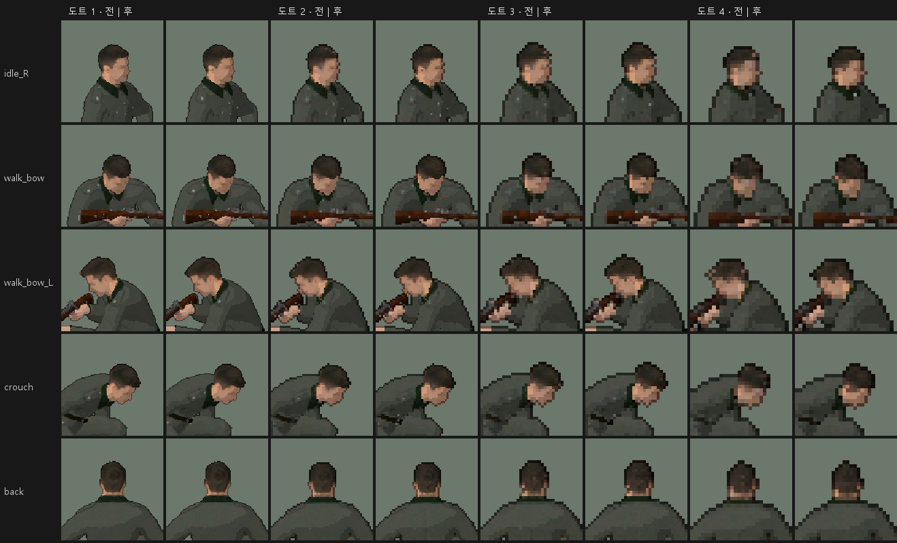

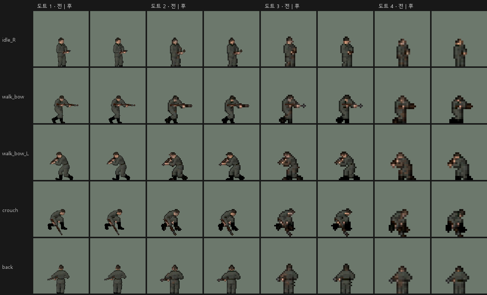

(행 = 자세 · 열 = 도트 1 ~ 4 의 전 | 후. 위 = 1 m 150 px(① 탭 기본) · 아래 = 40 px(게임) — 게임 크기에서 차이가 가장 크다)
  명암 값(단계 · 어두운 면 … · 매끈함)은 ① 탭이 열릴 때 넣으므로, 에디터를 켜고 ① 을 안 거친 채 ② ③ 부터 보면 기본값으로 보인다(예전과 같은 동작).

### 동작 표 인스펙터 (10-16)

`game/units/rifleman_motions.tres`(또는 병종 인스펙터의 `동작 표`)를 열면 기본 배열 편집기 대신 **상태별 편집 화면**이 나온다(Dot Rigger 플러그인이 붙임 — 에디터를 껐다 켠 뒤부터).

| | |
|---|---|
| 상태마다 동작 여러 개 | 그 상태가 되면 **비중(%)대로 하나**를 골라 튼다. 반복 동작(서기 · 앉기 …)은 한 바퀴 돌 때마다 다시 고른다 — 대기 중 가끔 두리번거리기 같은 것 |
| % | 줄마다 막대 + 숫자. 한 줄을 바꾸면 **나머지가 비율을 지킨 채 합 100** — 33 · 33 · 33 에서 첫 줄 20 → 20 · 40 · 40. `+ 동작` 은 새 줄 100/n %, `균등` 은 똑같이 |
| 상하체 합성 | `+ 상하체 합성` — 하체(골반 · 다리) 동작 + 상체(몸통 · 머리 · 팔) 동작, 길이 맞춤 · 반복 · 상체 방향 유지 · 몸통 각도. 2D 굽기의 합성과 **같은 코드로 내보낼 때 굽는다**(실행 중 섞는 연산 없음) |
| 동작 고르기 | 목록 = 프리셋 모델의 동작(UAL) + 추가 동작 폴더(Mixamo). 목록에 없는 이름은 ⚠ |
| 위 버튼 | `3D 동작 내보내기`(표 저장 → 이 표로 내보내기 → `library_path`) · `저장` · `동작 목록 다시 읽기` · `빈 상태도 보기`. 표에 있는데 3D 동작 묶음에 없는 동작이 있으면 ⚠ 로 알림 |
| 되돌리기 | 고칠 때마다 Ctrl+Z 한 칸 |

- 쓰는 상태만 보이고, 빈 상태는 맨 아래 `상태 추가` 로 넣는다. 상태 이름과 내려가는 순서(걷기+사격 → 서기+사격 → …)는 `game/data/motion_table.gd` 머리말.
- 예전 표(상태 → 이름 하나, 10-15 까지)는 불러올 때 자동으로 줄로 옮긴다(`A+B` 이름은 상하체 합성). `rifleman_motions.tres` 는 옮겨 저장해 둠 — 그 표로 내보낸 동작 묶음이 예전 것과 바이트까지 같음을 확인.
- 2D 화면도 같은 표로 비중대로 고른다(반복 때 다시 고르기는 3D 만).

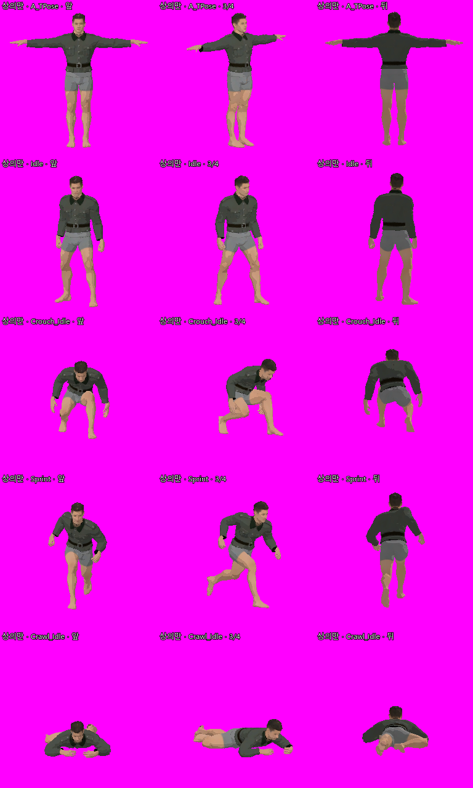

(군복 상의 + 내복 하의. 목 · 손목 · 허리 이음매에 틈 없음 — 슬롯 경계 구멍은 어두운 뚜껑으로 막는다)

## 코드 지도

```
addons/dot_rigger/
├─ core/motion_exporter.gd     DRMotionExporter — DRBaker.setup(프리셋 값)을 그대로 불러 처리된 동작을 AnimationLibrary 로 저장
├─ core/slot_mesh.gd           DRSlotMesh — 스킨드 통메시를 top · bottom · base 슬롯 메시로(2D 와 같은 경계, 겹침 0, 경계 뚜껑, 노멀 펴기 = 명암 매끈함)
├─ runtime/dr_character_3d.gd  DRCharacter3D — 병사 한 명: 몸 glb + 슬롯 3 + 소켓 장비(왼팔 IK), wear / take_off / set_tint / set_fade
├─ runtime/dr_hand_target_3d.gd  DRHandTarget3D — 무기 위 손 표지(왼손 · 오른손 side, 동작마다 IK 비중)
├─ runtime/dr_grip_mount_3d.gd   DRGripMount3D — 받침대(두 손 사이 보간 · 땅 고정, 10-16 잡기)
├─ runtime/dr_grip_solver_3d.gd  받침대 풀이 수정자(동작 자세로 받침대 자리 · 받침대 쪽 손 IK 목표)
├─ runtime/dr_aim_solver_3d.gd   조준 수정자(10-21, 차례 맨 앞 — 허리 · 가슴을 돌려 총구를 표적으로. 계산은 DRCharacter3D._solve_aim)
├─ core/equip_hold.gd          DREquipHold — 장비 모델 목록 · 지금 동작으로 무기 맞추기 · asset.json socket_hold 읽기/쓰기
├─ runtime/dr_grip_fit.gd      (옛) DRGripFit — weapon_asset 무기(소켓이 없을 때만)를 동작마다 두 손에 다시 맞춤
├─ runtime/dr_dot_view_3d.gd   DRDotView3D — 2D 캔버스 안의 "3D 창": 저해상도 렌더 · nearest 확대 · 도트 격자 스냅 · 외곽선
├─ shaders/dot_char.gdshader   몸 · 옷 · 무기 도트 명암 + 병사별 tint · fade(디더로 사라지기) · 옷 안쪽 면 어둡게 · 텍스처 반복 끔 · 비등방 · 안전 밉 지도(10-19)
├─ shaders/dot_edges.gdshader  외곽선 패스(바깥 1 도트 + 깊이로 겹친 병사 사이 선, 카툰 / 픽셀 퍼펙트)
├─ runtime/dr_motion_table.gd  DRMotionTable — 세트(DRMotionSet) · 상태 → 줄(DRMotionClip: 동작 · 비중 % · 상하체 합성) · 비중대로 고르기 · % 맞추기
├─ ui/motion_table_editor.gd   동작 표 편집 화면(인스펙터 — ui/motion_table_inspector.gd · ① 유닛 탭에 같은 화면)
├─ ui/unit_page.gd             ① 유닛 탭(DRUnitPage) — 유닛 프리팹 목록 · 자식 유닛 · 모습 칸 · 장비 요약 · 3D 미리보기 · 동작 표
├─ ui/equip_page.gd            ② 장비 탭(DREquipPage) — 소켓 · 장비 · 왼손 표지 편집기
├─ ui/outfit_page.gd           ③ 복장 탭(DROutfitPage) — 옷 붙이기 · 부위 경계 · 칠하기 · 슬롯 · 3D 미리보기
├─ tools/*_page_smoke_cli.gd   ① ② ③ 탭 창 없는 검사 · hub_smoke_cli(탭 창)
├─ tools/aim_check_cli.gd      조준 IK 창 없는 검사(10-21)
├─ tools/export_motions_cli.gd 동작 내보내기 명령줄(--check 로 2D 메모리 동작과 위치 차이 검사)
└─ tools/character3d_check_cli.gd  차림 4가지 · 이음매 · 무기 그립 그림 검사(창 모드)
game/
├─ view/battle_view_3d.gd      BattleView3D — BattleView(2D)를 물려받아 병사만 3D 로. 땅 · 상자 · 글자 · 총알 · 마우스 판정은 2D 그대로 · 조준 표적(10-21)
├─ motions/rifleman_anims.res  내보낸 동작 23개 + RESET (1 MB, 무손실 압축)
├─ view/equip_marks.gd         운용 장비(MG42 라페테 — 안건 F, 10-21) 자리 표시: 2D 땅 · 글자 층에 선 · 점(3D 모델 전, BattleView3D 도 물려받음)
└─ tools/view3d_smoke.gd       창 없는 3D 화면 검사
```

- **좌표:** DRDotView3D 가 3D 를 2D 캔버스와 같은 자리에 그린다 — 병사 자리 = `ground_to_world(to_canvas(x, 0, 깊이))`. 깊이(0~1)가 3D 앞뒤 거리가 되어 **겹침 순서는 깊이 버퍼가** 맡는다(2D 의 z 띠가 필요 없다). 정렬 오차 최대 0.63 도트.
- **방향:** 좌우를 보되 카메라 쪽으로 35° 돌려 3/4 가 보인다(`face_turn_deg`). 돌아설 때는 정면을 거쳐 돈다.
- **병사 한 명** = 노드 10개 남짓 · MeshInstance3D 3개(상의 · 하의 · 머리손) + 무기 씬(kar98k 는 메시 여럿 — 무기만 그리기 5번, 10-16 소켓 방식부터). 메시 · 재질 · Skin 은 병사끼리 같은 객체(공유), 병사마다 다른 값(어둡게 · 사라지기)은 instance uniform.
- **연산:** 동작은 초당 12번만(`step_hz` — 2D 퍼펫의 초당 12장과 같은 끊는 맛), 화면 밖 병사는 안 돌림. 노드 · 셰이더 값은 바뀔 때만 넣음. 슬롯 나누기 · 동작별 그립은 만들 때 한 번 · 캐시.

## 정한 것 · 2D 와 다른 점

- **(10-16 소켓 방식으로 갈음 — 아래는 10-15 의 기록)** **무기 그립을 동작마다 다시 맞춘다.** 장비 창에 저장된 kar98k 그립은 10-12 굽기 때 세트가 `Sprint` 하나뿐이라 **소총을 안 든 달리기 자세**에서 잡힌 것이었다 — 3D 소총 동작에 그대로 쓰면 왼손이 총열에서 28~39 cm 떨어지고 총이 세워진다. `DRGripFit` 이 그 동작의 두 손바닥으로 총열을 다시 잡는다(왼손 평균 0.3~0.8 cm). 동작이 바뀔 때는 섞는 시간(0.1 초) 동안 그립도 옮긴다. `asset.json` 은 안 고쳤다 — **2D 장비 그립도 소총 세트로 다시 잡는 편이 좋다**(사용자 몫).

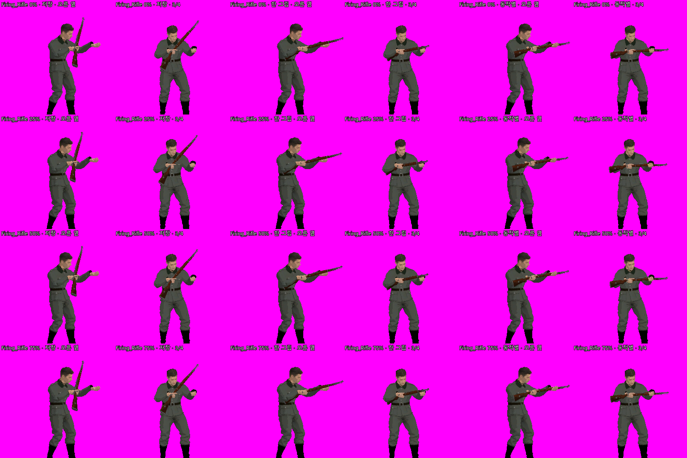

(Firing_Rifle. 왼쪽 둘 = 저장 그립 · 가운데 둘 = Rifle_Idle 한 그립 · 오른쪽 둘 = 동작별 그립)

- **반복 여부는 2D 와 같은 규칙**(원본의 loop — UAL 이름의 `_Loop` · Mixamo `.import` 의 Loop Mode · 합성 정의의 loop). 그래서 `Firing_Rifle`(서기+사격)은 한 번, `Crouch_Idle+Toss_Grenade` 는 반복. 바꾸려면 원본 설정을 고치거나 `export_motions_cli.gd --loop=keys`(표 키로: 사망 · 피격 · 장전 · 투척 · 근접 = 한 번).
- **제자리:** 이동 키(걷기 · 달리기 · 앉아걷기 · 포복)에 쓰인 동작은 내보낼 때 뿌리 이동을 지운다(`Walk_With_Rifle` 원래 3.2 m 전진). 사망 동작은 이동을 그대로 둔다 — 시체가 1.1~1.3 m 뒤로 밀려난다(발밑 그림자는 살아 있는 병사만).
- **동작 표에 `A+B` 합성이 있는데 프리셋에 없으면** 내보낼 때 프리셋 첫 합성의 설정으로 만든다(`Crouch_Idle+Rifle_Aiming_Idle` · `Crouch_Idle+Toss_Grenade`). 2D 로 구우려면 프리셋에도 넣어야 한다.
- **모든 동작이 같은 트랙 64개**(없는 뼈는 레스트 키) — Godot 4.7 AnimationPlayer 는 트랙이 없는 뼈를 앞 동작 자세로 남겨 둔다(Firing_Rifle → Idle 에서 비틀림 뼈 46° 그대로).
- **Animation 압축(손실)은 끔** — 1022 → 312 KB 로 줄지만 몇 동작에서 손 · 발이 수백 mm 튄다. 파일은 무손실 압축만.
- **"상의만" 이면 윗옷 자락(허리 아래)은 잘린다** — outfit.json 슬롯 표가 Hips 를 하의로 두기 때문(2D 와 같은 뜻). 자락을 상의로 하려면 ③ 부위 칠하기로 자락 정점을 Torso 로.

## 검사

```bash
G="C:/Users/Dev/Desktop/Godot_v4.7.2-stable_mono_win64/Godot_v4.7.2-stable_mono_win64_console.exe"
P="<프로젝트 사본>"   # 사용자 에디터가 연 진짜 프로젝트로는 돌리지 말 것
# 창 없는 3D 화면 검사 — 마지막 줄 "VIEW3D SMOKE OK"
"$G" --headless --path "$P" --script res://game/tools/view3d_smoke.gd -- --seconds=60 --squads=2 --seed=1941
# 동작 표 검사(예전 표 옮기기 · 비중대로 고르기 · % 맞추기 · 인스펙터 화면 · 세트) — 마지막 줄 "MOTION TABLE SMOKE OK"
"$G" --headless --path "$P" --script res://game/tools/motion_table_smoke.gd
# ① 유닛 탭(목록 · 미리보기 소켓 장비 · 칸 · 자식 유닛 상속 저장 · 자기 동작 표) — 마지막 줄 "UNIT PAGE SMOKE OK"
"$G" --headless --path "$P" --script res://addons/dot_rigger/tools/unit_page_smoke_cli.gd
# ② 장비 탭(소켓 · 왼손 IK · 자식 유닛 · 게임 길 · 뼈대 길이 든 사본) — "EQUIP PAGE SMOKE OK" / ③ 복장 탭 — "OUTFIT PAGE SMOKE OK" / 탭 창
"$G" --headless --path "$P" --script res://addons/dot_rigger/tools/equip_page_smoke_cli.gd
# 조준 IK(표적 방향 · 한계 · 흔들림 그대로 · 비중 0 · 왼손 · 빠르기 · 섞기 · 합성 · 엎드림 · 양손 받침대) — "AIM CHECK OK"
"$G" --headless --path "$P" --script res://addons/dot_rigger/tools/aim_check_cli.gd
"$G" --headless --path "$P" --script res://addons/dot_rigger/tools/outfit_page_smoke_cli.gd
"$G" --headless --path "$P" --script res://addons/dot_rigger/tools/hub_smoke_cli.gd
# 에디터 안(열린 씬 · 되돌리기 · 저장 · 미리보기 소켓이 뼈를 따라가나) — 창 없이, 저장소 통째 사본에서. 마지막 줄 "EDITOR CHECK OK"
python pipeline/check_editor.py --headless --sandbox="$P" --no-sync
# 동작 내보내기 + 2D 메모리 동작과 비교(손목 · 발목 · 머리 mm)
"$G" --headless --path "$P" --script res://addons/dot_rigger/tools/export_motions_cli.gd -- --check
# 창 모드 그림 검사는 보조 모니터로: --screen 0 (--position 에 음수를 주면 주 모니터로 끌려온다)
```

10-16 결과: 3D 화면 검사 통과(60초 · 병사 24명 · 동작 16종 · 멈춘 병사 0 % · 쓰러진 17명 풀로 돌아감 · 복장 보기 4가지 맞음 · 화면 갱신 평균 0.09 ms, 렌더 제외) · 동작 23개 2D 와 오차 0.000 mm · 같은 경로로 두 번 내보내면 바이트까지 같음.
10-16 저녁(① ② ③ 탭 3D 통합 뒤): 탭 검사 4개 · 3D 화면(무기 = 오른손 소켓 · 왼팔 IK · 왼손 붙임 ↔ 놓음 406번 · 화면 갱신 0.11 ms) · 동작 표 · 전투 시뮬 · 에디터 안 검사 21항목 전부 통과(모두 창 없이). 미리 만들기 24명 2.0 초 — 예전 방식과 같음.
10-16 밤(② 기즈모 뒤): 장비 탭 검사 [7] 기즈모 20항목 · 에디터 안 검사 24항목(기즈모 끌기 → 열린 씬 · 탭 창 Ctrl+Z / Ctrl+Y · 단축키) · 나머지 창 없는 검사 전부 통과.
10-16 저녁 2(도트 지저분함 · 머리 비어 보임 고친 뒤): 탭 검사 4개 · 3D 화면 · 동작 표 · 전투 시뮬 · 에디터 안 검사 25항목 전부 통과(창 없이, 커밋된 유닛 씬). 전후 그림은 위 표 아래.
10-19(동작별 무기 자리 · 안전 밉 지도): 장비 탭 검사 [9] 15항목 · 탭 검사 4개 · 3D 화면(왼손 IK 붙임 ↔ 놓음 406번 — 예전과 같음) · 동작 표 · 전투 시뮬 · 에디터 안 검사 26항목(이 동작만 끌기 → 메타 · Ctrl+Z / Ctrl+Y) 전부 통과(창 없이, 커밋된 트리로 새로 만든 사본).
10-21 밤 2(조준 표지 기즈모 · 도구 메뉴 내보내기 뺌): 장비 탭 [10] 표지 9항목 더함 · 탭 4개 · 조준 · 3D 화면 · 동작 표 · 전투 시뮬 · 안건 F · 에디터 안 28항목(총구 표지 만들기 → 기즈모 끌기 → Ctrl+Z 두 번) 전부 통과.
10-21 밤(옆 조준 뺌 · 총구 = 총열 축 · 조준 칸 설명): 조준 검사 35항목 · 장비 탭 [10] 21항목 · 탭 4개 · 3D 화면(한계 걸림 8 → 0) · 동작 표 · 전투 시뮬 · 안건 F 검사 · 에디터 안 27항목 전부 통과.
10-21 저녁(팔 · 견착 조준 · 미리보기 변화 없음 고침): 조준 검사 37항목 · 장비 탭 [10] 20항목(전체 97) · 탭 4개 · 3D 화면 · 동작 표 · 전투 시뮬 · 안건 F 검사 · 에디터 안 27항목 전부 통과.
10-21(조준 IK): 조준 검사 29항목 · 장비 탭 검사 [10] 16항목(전체 93) · 탭 검사 4개 · 3D 화면(왼손 IK 406번 그대로 + 조준 99 % · 겨눌 방향과 0.00°) · 동작 표 · 전투 시뮬 · 에디터 안 검사 27항목(조준 미리보기는 사본만 · 조준 비중 · 위 한계 → 열린 씬 루트 → Ctrl+Z / Ctrl+Y) 전부 통과(창 없이, 커밋된 트리로 새로 만든 사본 — 새 사본의 첫 에디터 실행은 셰이더 첫 컴파일 오류 줄 2개로 FAIL, 두 번째부터 OK — 10-19 와 같은 현상).

## 남은 것

- **사용자 확인:** 시험장을 창으로 띄워 보는 것은 사용자 지시로 멈춤(10-16) — 다음에 F6 으로. 에디터 안 길은 창 없는 에디터 탐침으로 확인했지만(① ② 열린 씬 · 되돌리기 · 저장), **기즈모로 끄는 손맛 · 화면 모습은 사용자 에디터에서** 봐야 한다.
- **장비 모습:** 맨손 동작(Sprint · Crouch_Idle · Crouch_Fwd · Crawl_Fwd)은 총이 오른손에 매달린 한 손 들기 — 소총용 달리기 · 앉기 동작이 있으면 제대로. 수류탄 동작은 총도 같이 움직임. 장전 동작은 AR 탄창 교체라 볼트 액션 kar98k 와 안 맞음.
- **운용 장비(안건 F, 10-21):** MG42 라페테는 아직 3D 모델 없이 `game/view/equip_marks.gd` 가 2D 땅 · 글자 층에 선 · 점으로 그린다(BattleView3D 도 물려받음). MG42 모델을 구우면
  `EquipmentType.prefab`(좌석 = Marker3D)과 동작 표 "MG42" 세트로 바꾼다. 좌석 병사의 3D 동작은 지금 앉기 + 조준 · 사격 · 장전(소총 동작을 빌림 — 조준 IK 도 소총 기준으로 돈다).
  고정 받침대 무기를 겨누는 것(장비 선회)은 몸 조준 IK 와 따로 — MG42 모델과 함께. 설계 · 기본값은 `보병_추상화.md` §2-13 · 코드는 `뼈대_구조.md`.
- **양손 받침대의 두 손 자리는 한 자세 기준:** `잡기 → 양손` 을 누른 그 자세에서 오른손 쪽 · 왼손 쪽 자리를 하나씩 기억해 모든 동작에 쓴다. 사용자가 저장한 양손 씬(10-16 19:06)을
  돌려 보니 Rifle_Idle 은 두 손 다 0.00 cm 인데 Firing_Rifle · Walk_With_Rifle 은 두 손 사이 가운데 놓인 총까지 왼팔이 모자라 6 ~ 8 cm 떨어짐(닿는 정도 1.10 ~ 1.14 — 코드 오류 아님:
  동작마다 두 손 사이 거리 · 방향이 달라(사격은 왼팔을 뻗음) 한 자세의 자리가 다른 동작에 안 맞음). → **10-19 동작별 무기 자리로 풀림**(② `이 동작만` → `맞추기`: 사격 6.7 → 0.0 cm · 걷기 5.0 → 0.0 cm, 위 ② 절). 사용자가 탭에서 동작마다 눌러 저장해야 한다.
- ~~kar98k 라이선스~~ → **10-21 저장소에 올림**(사용자: "무료로 받은 거"). 무기 씬 `kar98k.tscn` · 구운 그림도 같이 — 새로 받은 PC 도 기본형 군인이 무기를 든 채 열린다.
- **옛 무기 길:** 루트 칸 `weapon_asset` · `attach_weapon` · `DRGripFit` · `core/equip_baker.gd` 는 소켓이 없을 때만 쓰는 옛 길로 남김(2D 퍼펫 장비 런타임 `DREquipSet` · `equip/` 도 남음).
- **성능:** 안 잼(지시). 병사 한 명 삼각형 약 2.1만 — 100명 넘게 한 화면이면 낮은 LOD 를 고려. 로딩: 병사 24명 미리 만들기 1.7 초(첫 나누기 · 그립 계산 포함).
- 겹친 병사 사이 선은 깊이 차 0.5 m(전장 깊이 약 0.035) 이상일 때만 — 거의 같은 깊이에서 겹치면 선이 없다(2D 퍼펫은 늘 있었음).
- 목 둘레 1~2 px 어두운 선(군복 목 단면 > 몸 목, 뚜껑 테두리). `DRSlotMesh.CAP_COLOR` 로 밝기 조절.
- 게임을 내보낼(export) 때 `*.json`(outfit · parts · asset)을 포함해야 한다 — 런타임에 파일로 읽는다.
