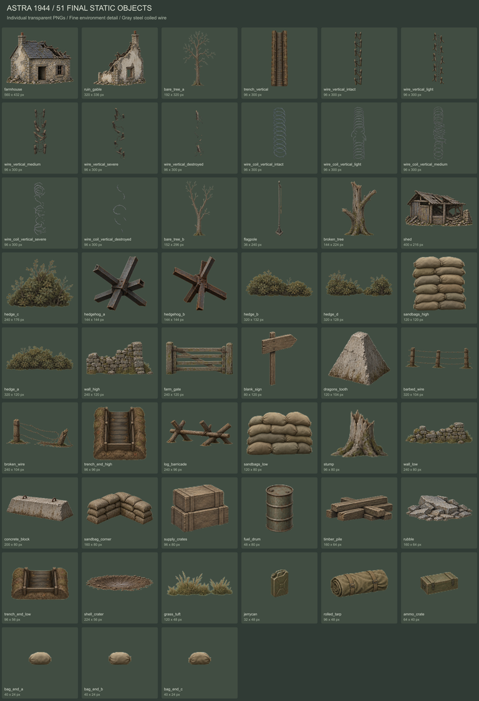
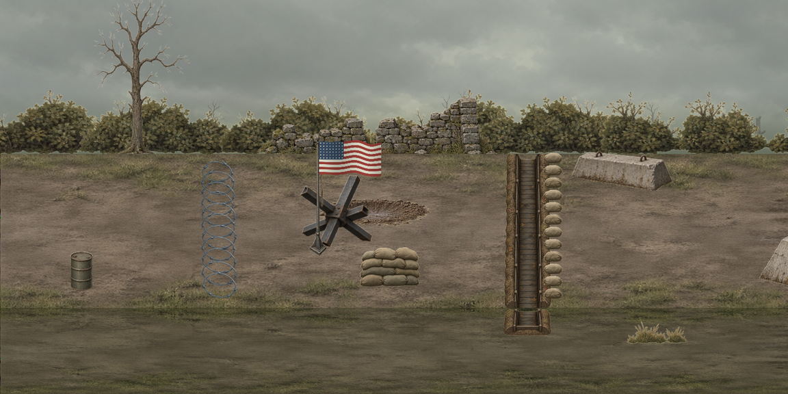

# 맵 리소스 — 2D 맵 그림 요청(아스트라) · 레이어 · 참호 버전

> 2026-10-28. 사용자: "이 게임에 맞는 맵 배경을 생성하고 싶은데, 참호(엄폐 공간)가 있는 맵이니까 … 맵은 2D 로 할 거거든" · "아스트라에게 맵 리소스는 부탁하려고".
> 병사는 3D(저해상도 · 외곽선으로 도트), 맵은 2D 그림. 그림은 아스트라(Codex 이미지 생성)에게 받는다.

## 화면 크기 기준

| 항목 | 값 |
|---|---|
| 카메라 | 옆에서 보되 15° 위에서 내려다봄(`dot_style.tres` pitch). 직교 — 원근 없음 |
| 게임 화면 | 1 m = 40 px(`BattleView.ppm`), 도트 2 px → **1 m = 20 도트**. 사람 키 ≈ 36 도트 |
| 땅 띠 | 깊이 0 ~ 1 = 화면 150 px(`depth_px`) = 75 도트. 병사가 이 안에서 앞뒤로 퍼져 선다(위 = 먼 쪽) |
| 요청 크기 | 아스트라 그림은 **도트 하나 = 4×4 화소**(1 m = 80 화소)로 크게 받아 게임 도트 격자로 줄인다(AI 그림은 도트가 고르지 않다) |
| 화면 확대 | 맵 그림 도트와 병사 도트를 맞추려면 정수 배(1 · 2배)만 — 지금 시험장은 1.1배씩 자유(나중에 고침) |

## 레이어(그리는 차례)

1. **먼 배경** — 하늘 · 먼 풍경 실루엣(좌우 이어짐, 패럴랙스). 병사 뒤.
2. **땅 띠** — 병사가 서는 땅(15° 위에서 본 진흙 · 풀). 병사 뒤.
3. **엄폐물 · 소품** — 병사와 겹치는 것. 병사가 땅 띠 안에서 앞뒤로 퍼져 서므로 2D 앞판 한 장을 병사 위에 덮으면 깊이마다 가리는 양이 틀린다
   → 병사를 가려야 하는 것은 게임이 **3D 창 안 제 깊이에 판으로** 세운다(깊이 버퍼가 가림을 맡음 — 지금 참호 버전 모래주머니가 이 방식).
   병사 뒤에만 깔리는 것(도랑 안 · 포탄 구멍)은 땅 층.
4. **맨 앞 가림**(선택) — 화면 맨 아래 앞풀 · 철조망 실루엣.

## 참호 버전 엄폐물(10-28 — 02 U58)

사용자: "지금 엄폐물 앉아서, 그 엄폐물이 그 형식대로 참호 버전이 있었으면" · "참호 안이 다 보여야지".

- 엄폐물(낮음 · 높음)마다 **참호 버전**(`BattleCover.dug`) — **시뮬은 모래주머니 판과 똑같다**(구간 · 칸 · 벽 쪽 · 벽 높이 · 쏘는 / 숨는 자세 · 총알 판정). 모습만 땅을 판 것.
- 모양은 **워페어 참호**(사용자가 보여 준 Warfare 리메이크 화면): 벽 쪽 끝에 폭 1.2 m(`TRENCH_W`)의 좁은 도랑이 깊이 방향으로 길게 · 바닥 판자 · 양옆 말뚝,
  칸은 도랑 가운데 한 줄로 앞뒤로 늘어선다(병사가 한 줄로 서서 적 쪽을 본다).
- 도랑 깊이 = 벽 높이 − 모래주머니 0.3 m(낮음 0.7 m · 높음 1.2 m). 도랑(벽 쪽 1.2 m · 깊이 전체) 안의 것은 그만큼 내려 그린다
  (`Battlefield.draw_ground_h` — 병사 · 총알 자국 · 맞은 점 · 조준점 · MG42 표시). 보이는 벽은 땅 위 모래주머니 0.3 m.
- 화면: 도랑은 **잘라 낸 단면**(안이 다 보임) — 깊이 전체가 어두운 흙, 띠 아래로 도랑 깊이만큼 앞쪽 단면. 병사는 도랑 바닥에 선 채 몸 전체가 보인다.
  적 쪽 끝 모래주머니는 깊이마다 3D 판(지금은 코드로 그린 임시 그림).
- 시뮬에서 몸을 실제로 내렸던 첫 판은 총구도 땅 가까이 내려가 퍼진 총알이 땅에 박혀 쏘는 쪽이 불리했다(씨앗 7 MG42 48발 0 맞음) → 그리기만 내린다.


(사용자 씬 · 시험장 10-28 · 지금 카메라 15°. 왼쪽 · 오른쪽 좁은 판자 도랑 = 참호 버전 낮은 엄폐물(오른쪽에 분대가 한 줄로), 가운데 = 원래 높은 엄폐물(모래주머니 판 — 세로 막대는 임시 벽 표시))

**카메라 각도 결정(10-28)** — 15° · 땅 띠 150 px 그대로, 참호 모습도 위 그림 그대로("15도가 예쁘다. 지금같이 이걸로 하자").
워페어처럼 40° · 땅 띠 360 px 로도 찍어 비교했지만 쓰지 않는다. 아스트라 요청도 15° 기준.

## 아스트라 요청(붙여 넣기용)

첨부 1 = `img/맵_기준_게임화면.png`(병사 도트 크기 · 색감 · 각도), 첨부 2 = `img/보병_참호버전.png`(참호 버전 자리 · 크기).

```
2D 횡스크롤 전쟁 게임(1944 서부전선) 배경용 픽셀 아트 리소스를 부탁해.
첨부 1 = 우리 게임 화면(병사 도트 크기·색감·각도 기준), 첨부 2 = 참호 버전 엄폐물이 들어간 게임 화면(자리·크기 기준 — 판자 도랑 · 모래주머니 · 글자는 임시 표시).

[공통]
- 카메라: 옆에서 보되 15° 위에서 살짝 내려다봄(땅 윗면이 납작하게 보임). 원근 없음(멀어도 크기 같음, 소실점 없음).
- 도트 하나 = 4×4 화소로 크게. 1 m = 80 화소(사람 키 약 144 화소). 첨부 1의 병사와 같은 도트 크기.
- 어두운 1도트 외곽선, 명암 3단계, 채도 낮은 흙·풀·회색.
- 사람, 차량, 글자는 넣지 말 것.
- 빈 곳은 투명. 투명이 안 되면 순수 자홍색(#FF00FF) 한 색으로.
- 그림 판 크기가 정해져 있으면 작은 조각은 한 장에 여러 개 띄워 놓아도 됨. 화소 수보다 크기 비율(1 m = 80 화소)을 지킬 것.

[분위기]
- 1944 서부전선 시골 전장: 진흙 들판, 생울타리와 돌담, 부서진 농가, 포탄 구멍, 철조망. 늦가을 흐린 날.
- 덩어리 큰 색면 위주로 단순하게, 잔무늬는 적게. 병사가 가장 잘 보여야 하므로 배경은 병사보다 명암 대비를 낮게, 멀수록 더 흐리고 푸르스름하게.
- 빛줄기 · 강한 그림자 · 채도 높은 색 같은 화려한 효과 없이 차분한 전장 그림.
- 참호와 소품은 실제 쓰던 물건처럼 투박하게(판자 바닥, 나무 말뚝, 모래주머니). 과장된 장식 금지.

[1] 먼 배경 2장 (가장 뒤, 좌우 끝이 이어지게, 1536×1024)
  a. 흐린 가을 하늘과 먼 연기
  b. 먼 풍경 실루엣(언덕, 나무 줄, 부서진 마을) — 아래쪽 1/3에만, 위는 비움

[2] 땅 띠 타일 (병사가 서는 땅, 좌우로 이어지게)
  - 진흙, 풀, 바퀴 자국이 있는 땅을 15° 위에서 내려다본 모습
  - 세로 300 화소(깊이 14 m가 납작하게 보인 것), 가로 1536

[3] 참호 버전 엄폐물 (땅을 판 좁은 도랑 — 첨부 2의 판자 도랑)
  a. 도랑(병사 뒤에 깔림): 화면 위아래로 길게 이어지는 좁은 도랑을 위에서 본 모습 — 바닥 판자, 양옆 나무 말뚝과 판자 벽, 어두운 흙.
     폭 1.2 m(96 화소) × 세로 300 화소(땅 띠와 같은 높이, 위아래로 이어지는 타일). 안이 다 보이게(앞을 가리는 둑 없음).
     아래 끝 조각 0.7 m(56 화소) 하나 더(맨 앞 깊이 병사 발밑까지 — 높은 엄폐물용은 1.2 m · 96 화소).
  b. 모래주머니 한 단(적 쪽 끝에 게임이 깊이를 따라 쌓음): 끝에서 본 모래주머니 더미, 가로 0.5 m(40 화소) × 높이 0.3 m(24 화소), 윗면이 살짝 보이게. 2~3가지.

[4] 모래주머니 더미 (보통 엄폐물, 옆에서 본 모습, 가로 1~1.5 m): 낮은 것 1.0 m(80 화소), 높은 것 1.5 m(120 화소)

[5] 소품 (하나씩 따로): 철조망, 대전차 장애물(체코 고슴도치), 부러진 나무, 포탄 구멍(땅에 납작하게 놓는 것), 무너진 벽, 탄약 상자, 나무 말뚝

[6] (선택) 맨 앞 가림: 화면 맨 아래를 지나가는 앞풀·철조망 실루엣, 좌우로 이어지게
```

보내는 법: 위 글 전체 + 첨부 1 · 2 를 한 번에 주고, 그림은 한 번에 한 항목씩 받는다(참호 [3] 먼저). 이 md 파일 자체는 주지 않는다(코드 이름 · 내부 메모가 섞여 있음).
워페어 1944 스샷은 같이 주지 않는다 — 카메라 · 크기가 달라(깊이 없는 완전 옆모습) 그쪽 각도로 그려 오고, 다른 게임 그림체를 닮은 리소스가 나오기 쉽다.
게임 이름도 넣지 않는다(10-29) — 이름을 대면 그 게임 그림을 닮게 그려 오기 쉽고, 게임을 낼 때 남의 그림체를 따라 했다는 문제가 될 수 있다. 원하는 배경 느낌 · 디자인은 [분위기]에 말로 적는다.
참고로 찾아본 것: 워페어 1917 은 한 줄 전장 · 참호 하나에 유닛 3개까지, 워페어 1944 는 참호 대신 엄폐물(울타리 · 생울타리 · 돌담 · 모래주머니) · 엄폐물 하나에 분대 하나 · 위 · 가운데 · 아래 세 줄.

## 받은 리소스(10-30)

아스트라가 그림을 Godot 예제 프로젝트(`Astra_1944_Resource_Pack`)로 묶어 줬다. **쓸 리소스만 `game/map/` 으로 옮기고 예제 프로젝트는 지웠다**(휴지통).
아직 화면에 붙이지 않았다 — 지금 시험장은 예전 임시 그림 그대로.

| 위치 | 내용 |
|---|---|
| `game/map/art/backgrounds/` | `sky_overcast` 흐린 하늘 1536×1024(좌우 이어짐) |
| `game/map/art/ground/` | 땅 띠 `ground_plain` · `ground_ruts`(바퀴 자국) · `ground_wet`(진흙 · 물웅덩이) 1536×300 = 깊이 14 m |
| `game/map/art/trenches/` | `trench_vertical` 좁은 판자 도랑 96×300(폭 1.2 m · 위아래 12 px 겹쳐 이음) · 아래 끝 `trench_end_low` 96×56 · `trench_end_high` 96×96 |
| `game/map/art/cover/` | 적 쪽 모래주머니 한 단 `bag_end_a` ~ `c` 40×24 · 모래주머니 더미 `sandbags_low` 120×80 · `sandbags_high` 120×120 |
| `game/map/art/landmarks/` | 부서진 농가 `farmhouse` · 헛간 `shed` · 무너진 집 벽 `ruin_gable` |
| `game/map/art/scenery/` | 생울타리 `hedge_a` ~ `d` · 나무 `bare_tree_a` · `b` · `broken_tree` · 그루터기 `stump` · 돌담 `wall_low` · `wall_high` · 농장 문 `farm_gate` · 풀 `grass_tuft` |
| `game/map/art/obstacles/` | 체코 고슴도치 `hedgehog_a` · `b` · 용치 `dragons_tooth` · 철조망 울타리 `barbed_wire` · `broken_wire` · 통나무 바리케이드 · 콘크리트 블록 · 포탄 구멍 `shell_crater` · 모래주머니 모서리 |
| `game/map/art/supplies/` | 탄약 상자 · 보급 상자 · 드럼통 · 기름통 · 말린 천막 · 목재 · 잔해 `rubble` · 빈 표지판 · 깃대 `flagpole` |
| `game/map/art/wire_posts/` · `wire_coils/` | 깊이 방향 철조망 — 말뚝형 · 윤형(회색) 각 5 상태: `intact` 정상 · `light` 보병 절단 · `medium` 전차 압착 · `severe` 포격 · `destroyed` 잔해. 96×300, 기준점 (48, 298). 상태끼리 좌표가 맞는 애니 프레임은 아님 |
| `game/map/art/flags/` | 깃발 문양 SVG — `usa_48_stars`(미국 48성기) · `france` · `neutral` |
| `game/map/map_assets.json` | 그림마다 크기 · **기준점(anchor = 땅에 닿는 점)** · 미터 크기 · 철조망 상태 · 땅 잇기 · 깃발 방법 |
| `game/map/shaders/` | `ground_blend` — 땅은 그 자체로 이음매 없는 타일이 아니다: 1536 px 조각을 **1408 px 간격**으로 놓고 두 번째부터 왼쪽 128 px 를 서서히 투명하게. `flag_wave` — 잘게 나눈 Polygon2D(28 × 4 칸)에 문양을 입혀 흔듦 |





(위 두 장은 아스트라 미리보기 — 우리 게임 화면이 아니다. 깃발 · 도랑 · 철조망 놓인 모습 참고용.)

**요청과 다른 점**
- **도트가 아니라 1 화소 단위 세밀한 그림**(80 px = 1 m). 아스트라 판단: 환경만 세밀하게, 병사는 굵은 도트 그대로. 게임 화면은 40 px = 1 m 라 0.5 배로 그리면 크기는 맞는다.
  병사처럼 도트 느낌으로 맞출지(1/4 로 줄여 1 m = 20 도트) 세밀한 그대로 둘지는 사용자 확인.
- 먼 풍경 실루엣([1] b)과 맨 앞 가림([6])은 없다 — 긴 수목 배경은 이음이 어색해 빠졌고, 수풀 · 나무 · 담 · 집을 하나씩 놓는 방식.
- 생성 프롬프트에 워페어 이름이 들어갔다(10-29 에 넣지 않기로 했던 것). 그림은 이미지 입력 없이 글로만 새로 생성. 프롬프트 전문 = `아스트라_프롬프트.txt`(같은 그림체로 더 받을 때 이것을 고쳐 쓴다 — 이름은 빼고).

**버린 것**: 예제 프로젝트(데모 씬 · 깃발 점령 예제 · 검사 스크립트 · `project.godot`), 2배 철조망 10장, 아틀라스 시트(개별 그림과 같음), 원본 생성 그림 · 미리보기(약 50 MB).

## 받은 뒤 할 일

- 크기: 그림 80 px = 1 m → 화면 0.5 배. 도트로 줄일지 세밀한 그대로 둘지 사용자 확인(위).
- 참호 버전: `trench_vertical` = 땅 층 도랑(`BattleView._draw_dug_cover` 자리), `bag_end_a` ~ `c` = 깊이마다 세우는 3D 판의 그림(`BattleView3D.build_trench_cards` 의 `_sandbag_tex` 자리).
- 엄폐물 · 소품을 씬에 놓는 방식(지금은 `game/tools/test_field.gd` 코드) · 화면 확대 정수 배.
