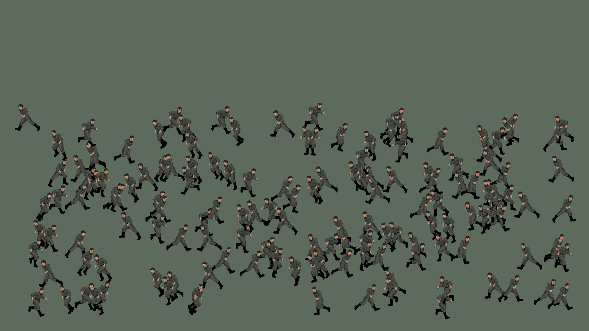
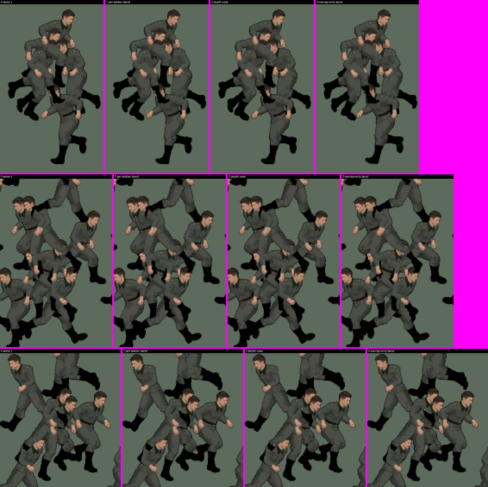

# 부하 시험 결과 — 퍼펫 100명 이상을 한 화면에

> 2026-10-13. `보병_추상화.md` §4 의 1번. **결론: 퍼펫 방식 그대로 간다**(스프라이트 시트로 갈아탈 필요 없음).
> 시험장: `test/load_test.tscn`(F6 로 직접 볼 수 있음 · 명령줄 `--auto` 로 자동 측정). 원자료: `pipeline/check/load_test/`(저장소 밖).

## 조건

- PC: i5-14400F · RTX 5060 — **개발용 PC 라 빠른 편**. 목표 PC 가 느리면 아래 숫자는 그만큼 나빠진다.
- 창 1920×1080 · 수직동기 끔 · Godot 4.7.2 · Forward+ (D3D12) — 지금 프로젝트 설정 그대로.
- 병사 = `DRPuppetSet`(Sprint 세트) + 군복(`uniform_m36`). 키는 화면 높이의 약 10 %. 절반은 왼쪽을 봄. 발 박자는 제각각.
- 퍼펫 하나 = **노드 63개**(뼈 15 · 그림 30장 = 조각 15 + 외곽선 밑깔개 15) + 애니 트랙 45개.
- 재지 못한 것: **장비**(무기) — Sprint 세트용으로 구운 장비가 아직 없다. 장비는 병사당 그림 1~3장이 느는 정도.



## 1. 병사 수에 따른 속도

| 병사 | 한 프레임 | 초당 프레임 | 가장 느린 1 % | 노드 수 |
|---:|---:|---:|---:|---:|
| 50 | 2.4 ms | 421 | 303 | 3,255 |
| 100 | 5.0 ms | 198 | 154 | 6,505 |
| **150** | **7.7 ms** | **130** | 113 | 9,755 |
| 200 | 10.4 ms | 96 | 83 | 13,005 |
| 300 | 15.7 ms | 64 | 58 | 19,505 |
| 400 | 21.0 ms | 48 | 44 | 26,005 |

- 병사 한 명 = **약 0.052 ms**. 수에 정비례한다(갑자기 꺾이는 지점 없음).
- 60 fps(16.7 ms)가 되는 한계는 이 PC 에서 **약 300명**. 게임 논리(두뇌 · 총알)가 쓸 시간을 남기려면 **150~200명**이 편한 범위.

## 2. 시간이 어디서 드나 (150명)

| 경우 | 한 프레임 | 뜻 |
|---|---:|---|
| 전부 켬 | 7.7 ms | |
| 애니 멈춤(그리기만) | 2.0 ms | 그리는 값 ≈ 1.8 ms |
| 숨김(애니만) | 3.9 ms | 뼈를 움직이는 값 ≈ 3.7 ms |
| 빈 화면 | 0.2 ms | |

- **가장 큰 몫은 뼈를 움직이는 일(CPU)** 이다. 그래픽 카드는 거의 놀고 있다(GPU 0.5 ms).
- 둘을 더하면 5.7 ms 인데 전부 켜면 7.7 ms — 남는 2 ms 는 "움직인 조각의 새 자리를 그리는 쪽에 알리는" 값(움직이면서 보일 때만 든다).
- 군복을 입혀도 값은 같다(맨몸 7.7 ms) — 복장은 그림만 바꿔 끼우는 것이라 공짜.

## 3. 줄이는 방법 — 애니를 덜 자주 갱신

| 애니 갱신 | 한 프레임 (150명) |
|---|---:|
| 매 프레임 | 7.7 ms |
| 2 프레임마다 | 5.1 ms |
| 3 프레임마다 | 4.4 ms |

- 구운 동작은 **초당 12장**이다. 60 fps 화면에서 3 프레임마다(= 초당 20번) 갱신해도 그림 정보는 잃지 않는다.
- 병사의 **자리 이동은 매 프레임** 그대로(값이 거의 안 든다) → 걷는 것은 부드럽고 팔다리만 덜 자주 바뀐다. 도트 그림에는 오히려 맞는 느낌(인수인계 02 의 측정: 12 fps 계단 재생이 깜빡임 0 %).
- → **기본값 제안: 애니 갱신 초당 20~30번 고정.** 화면 밖 병사는 멈춤.

## 4. 겹칠 때 그리는 순서 (새로 알게 된 것)

퍼펫 조각은 z_index 를 −1(외곽선 밑깔개) · 10~150(조각)으로 쓴다. 병사를 그냥 띄우면 겹친 병사끼리 **조각이 z 별로 섞인다** — 모든 병사의 외곽선이 맨 뒤로 가서 겹친 병사 사이 테두리가 사라지고, 뒤 병사의 팔이 앞 병사 몸통 위로 올라온다.



(왼쪽부터 ① 같은 z — 섞임 ② 병사마다 z 띠 ③ 깊이 줄 12개 ④ 겹치는 병사끼리만 다른 띠)

| 방식 | 150명 | 300명 | 바른가 | 비고 |
|---|---:|---:|:---:|---|
| 같은 z | 8.1 ms | 16.6 ms | ✗ | 겹치면 섞임 |
| 병사마다 z 띠 | 8.1 ms | 16.3 ms | ✓ | 조각 z 를 0,1,2… 로 다시 매겨야 함(구운 값 그대로면 53명까지) |
| 깊이 줄 12개 | 8.2 ms | 16.6 ms | △ | 같은 줄 안에서는 섞임 |
| **겹치는 병사끼리만 다른 띠** | 8.3 ms | 16.1 ms | ✓ | **구운 z 그대로.** 띠 150명 25개 · 300명 46개 · 400명 63개(넘침) |

- **속도는 방식과 상관없다**(그리기 호출 수도 같다. 표의 차이는 측정 오차 범위) → 바른 방식을 쓰면 된다.
- Godot 의 z 는 −4096 ~ 4096 뿐이고 병사 한 명이 폭 153 을 쓰므로 띠는 **53개**까지.
- **겹치는 병사끼리만 다른 띠**: 깊이 순으로 훑으며 "화면에서 나와 겹치는 더 뒤 병사의 띠 + 1" 을 준다. 필요한 띠 수는 병사 수가 아니라 **가장 길게 겹쳐 이어진 줄의 길이**다. 구운 퍼펫 · Dot Rigger 를 안 고쳐도 된다.
- → **채택.** 300명 가까이 몰려 띠가 모자라면 그때 조각 z 다시 매기기를 더한다(폭 153 → 16~32).

## 5. 병사를 만드는 시간 (투입할 때 끊김)

| 조건 | 한 명 |
|---|---:|
| 그냥 만들기 | **7.0 ms** |
| 퍼펫 씬 파일을 누가 붙들고 있을 때 | **2.2 ms** |
| (그 안에서) 씬 만들기만 | 0.3 ms |
| (그 안에서) rig.json 읽기 — `reload()` 가 두 번 읽음 | 0.6 ms × 2 |

- 원인: `DRPuppetSet.reload()` 가 `load(씬)` 을 부르는데, 아무도 그 씬을 붙들고 있지 않으면 **병사마다 씬 파일을 디스크에서 다시 읽는다**(약 5 ms).
- 6명 분대를 한 번에 투입하면 7 ms × 6 = 42 ms → 60 fps 에서 두세 프레임 끊긴다.
- → **대책(게임 쪽, Dot Rigger 수정 없이)**: ① 전투를 시작할 때 퍼펫 씬을 읽어 붙들어 둔다(2.2 ms). ② 병사를 **미리 만들어 두고 돌려 쓴다**(끊김 0 — 150명 미리 만들기 ≈ 0.3~1 초, 로딩 때).
- 더 줄이려면 `DRPuppetSet` 이 rig.json 을 한 번만 읽게 고친다(−1.2 ms). 다시 구운 뒤 옛 값을 쓰는 사고가 날 수 있어 지금은 손대지 않음.

## 6. 렌더러 비교

| 렌더러 | 150명 | 300명 |
|---|---:|---:|
| **Forward+ (지금 설정)** | **7.7 ms** | 15.7 ms |
| 호환 (OpenGL) | 11.8 ms | 23.4 ms |

- 지금 설정(Forward+)이 더 빠르다 → 그대로 둔다.

## 설계에 반영한 것

1. **표현은 퍼펫 그대로.** 스프라이트 시트로 바꾸는 일은 하지 않는다(갈아 끼울 수 있는 구조는 유지).
2. **애니 갱신은 초당 20~30번**, 자리 이동은 매 프레임. 화면 밖은 애니 멈춤.
3. **겹침 순서 = 겹치는 병사끼리만 다른 z 띠**(구운 z 그대로).
4. **병사는 미리 만들어 두고 돌려 쓴다** + 퍼펫 씬을 붙들어 둔다.
5. 목표 병력은 **한 화면 150~200명**을 기준으로 잡는다(이 PC 에서 150명이면 논리에 9 ms, 애니 갱신을 줄이면 12 ms 가 남는다).

## 다시 재는 법

```bash
G="C:/Users/Dev/Desktop/Godot_v4.7.2-stable_mono_win64/Godot_v4.7.2-stable_mono_win64_console.exe"
P="C:/Users/Dev/git/Godot/SideProject"
"$G" --path "$P" --resolution 1920x1080 res://test/load_test.tscn -- --auto --out="$P/pipeline/check/load_test/forward"   # 약 2분, 창이 떴다 닫힘
"$G" --path "$P" --resolution 1920x1080 res://test/load_test.tscn -- --spawn-probe                                          # 만들기 시간
```

- 다른 PC 에서 볼 때: 에디터에서 `test/load_test.tscn` 을 열고 F6 → `V`(수직동기 끔) → `↑↓` 로 병사 수를 바꿔 본다.
- 에디터가 이 프로젝트를 열고 있을 때는 명령줄로 돌리지 않는다(가져오기 캐시 — 인수인계 규칙).
