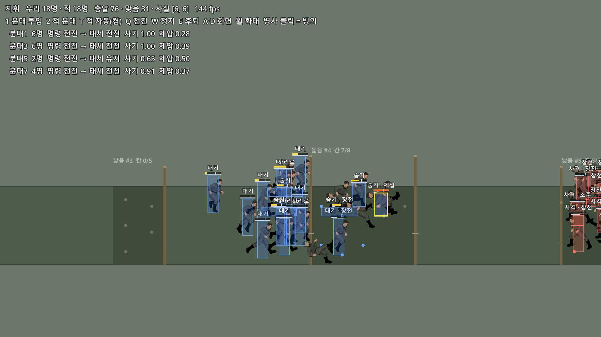

# 전투 뼈대 — 코드 구조와 쓰는 법

> 2026-10-13. `보병_추상화.md` §4 의 3번. 설계 문서에서 정한 구조를 **돌아가는 최소 코드**로 옮긴 것.
> 병사들이 맵 양 끝에서 분대째로 나와 엄폐물에서 엄폐물로 전진하고, 쏘고, 제압당하고, 무너진다. 병사 하나를 직접 조종(빙의)할 수 있다.
> 숫자(사거리 · 피해 · 점수 가중치)는 전부 **임시값**이다 — 구조를 보려고 넣은 값.

## 바로 보기

- 에디터에서 **`game/battle_test.tscn`** 을 열고 **F6**.



(분대 4 대 4. 우리 편이 가운데 엄폐물에 들어가는 중 — 노랑 막대 = 쌓이는 제압, 노랑 테두리 = 제압당해 숨은 병사, 오른쪽 끝 = 엄폐물 뒤에서 쏘는 적)

| 평소(지휘) | |
|---|---|
| `1` / `2` | 우리 편(왼쪽) 분대 투입 / 적 분대 투입 |
| `T` | 적 자동 투입 켬/끔 |
| `Q` `W` `E` | 우리 편 모든 분대에 전진 / 정지 / 후퇴 (강제가 아니라 가중치) |
| `A` `D` · 휠 · `Space` | 화면 이동 · 확대 · 멈춤 |
| 우리 병사 클릭 | **빙의** |

| 빙의 중 | |
|---|---|
| `A` `D` · `Shift` | 이동 · 달리기 |
| `W` `S` | 깊이(화면 안쪽 / 앞쪽) |
| `C` · `Z` | 앉기 · 엎드림 (다시 누르면 서기) |
| 마우스 · 왼쪽 단추 · `R` | 조준 · 사격 · 장전 |
| `Esc` | 풀기(원래 분대로 돌아감) |

| 보기 | |
|---|---|
| `F1` `F2` `F3` | 판정 상자 · 상태 글자 · 병사 그림 켬/끔 |
| `F4` `F5` | (3D) 복장 보기(병종 복장 → 상의만 → 하의만 → 내복) · 도트 크기 |

- 화면 왼쪽 위: 분대별 명령 → 태세 · 사기 · 제압. 그 아래: 마우스 아래(또는 빙의한) 병사의 **실행 중 상태** — 두뇌가 고른 의도와 점수 · 몸 상태 · 지금 동작 · 제압 · 탄약.
- 파랑 상자 = 우리 편 · 빨강 = 적 · 노랑 테두리 = 제압 · 흰 테두리 + ★ = 빙의 중. 상자 크기가 **실제 판정 상자**(서기 / 앉기 / 엎드림)다.
- **10-16 부터 병사는 3D 캐릭터**(`BattleView3D` — `3D_전환.md`). 예전 2D 퍼펫 화면은 시험장 노드의 `use_3d` 끄기 또는 `-- --view=2d`.

## 폴더

```
game/
├─ data/                  인스펙터에서 고치는 데이터의 "틀"(Resource 스크립트)
│   ├─ soldier_type.gd      병종 — 능력치 · 특성 · 분대 인원 · 무기 · 판정 상자 · 외형 · 동작 표
│   ├─ weapon_data.gd       무기 — 사거리 · 연사 · 탄창 · 피해 · 퍼짐 원 · 제압
│   └─ motion_table.gd      동작 표 — 상태 이름 → 퍼펫 동작 이름
├─ units/                 실제 값(.tres) ← ★ 여기를 인스펙터로 고친다
│   ├─ rifleman.tres        소총수
│   ├─ kar98k.tres          Kar98k
│   └─ rifleman_motions.tres  소총수 동작 표
├─ sim/                   논리 — 화면과 무관하게 돈다
│   ├─ battlefield.gd       전장 관리자(병사 · 분대 · 엄폐물 기록을 들고 한 걸음씩 돌림, 사기 · 패주 · 패닉 · 빙의)
│   ├─ battle_soldier.gd    병사 기록(노드 아님)
│   ├─ battle_squad.gd      분대 기록
│   ├─ battle_cover.gd      엄폐물 기록(구간 · 높이 · 벽 · 칸)
│   ├─ squad_brain.gd       분대 두뇌 — 점수제(태세 → 목표 지점 · 엄폐 예약 · 자리)
│   ├─ soldier_brain.gd     병사 두뇌 — 점수제(자리로 · 사격 · 장전 · 숨기 · 대기, 표적 고르기)
│   ├─ battle_body.gd       몸 — 상태머신(이동 · 행동 두 영역 + 덮어쓰기)
│   └─ ballistics.gd        명중 — 퍼짐 원 + 경로 판정
├─ view/
│   ├─ battle_view.gd       화면(2D) — 기록을 읽어 그리기만(퍼펫 풀 · 애니 갱신 · z 띠 · 상자 · 글자 · 총알 자국)
│   └─ battle_view_3d.gd    화면(3D, 기본) — battle_view 를 물려받아 병사만 3D 캐릭터로(3D_전환.md)
├─ motions/
│   └─ rifleman_anims.res   3D 동작 묶음 — 에디터 도구 메뉴 "Dot Rigger — 3D 동작 내보내기" 가 만든다
├─ tools/
│   ├─ make_default_units.gd  units/ 의 기본 리소스 만들기(없을 때만)
│   ├─ sim_smoke.gd           화면 없는 논리 검사
│   ├─ view3d_smoke.gd        창 없는 3D 화면 검사
│   └─ test_field.gd          시험용 전장(엄폐물 배치)
└─ battle_test.tscn / .gd   전투 시험장(입력 · 카메라 · 화면 글자)
```

## 설계 문서와의 대응

| 설계(§) | 코드 |
|---|---|
| 유닛 = 데이터 · 조종자 · 몸 · 표현 (2-2) | `SoldierType` · `SoldierBrain`/플레이어 · `BattleBody` · `BattleView` |
| 조종자 바꿔 끼우기 = 빙의 (2-3) | 병사 기록의 **의도 칸**(`want_*` · `goal_*` · `move_dir` · `aim_*`)을 AI 두뇌가 채우느냐, `battle_test.gd` 의 `_drive_possessed()` 가 키보드 · 마우스로 채우느냐의 차이뿐. 몸은 같다 |
| 몸 상태머신 (2-4) | `BattleBody.step()` — 병사는 상태 번호 + 타이머만 가진다. 상태 객체 · 노드 없음 |
| 100명 대비 (2-6) | 병사 · 분대 = `RefCounted` 기록, x 를 4 m 구역으로 나눠 조회, 총알은 즉시 판정 + 늦게 적용 |
| 분대 (2-7) | `SquadBrain` — 무거운 조회는 분대 수만큼만. 병사 자리는 가중치("자리로" 점수)로 받는다 |
| 사기 · 제압 (2-8) | 제압 = 병사(`suppression`), 사기 = 분대(`morale`). 패주 = `Battlefield._update_squad_state`, 패닉 = `panic()` |
| 엄폐 (2-9) | `BattleCover` — 칸 예약, 높이별 쏘는 / 숨는 자세. 제압 = 숨는 자세로 강제 |
| 명중 (2-12) | `Ballistics.fire()` · `trace()` — 원 = 높이 × 깊이, 처음 닿는 것에 맞음, 아군 통과, 근처 통과 = 제압 |
| 데이터 · 인스펙터 (2-11) | `game/units/*.tres` + 시험장의 실행 중 상태 글자. **전용 인스펙터 화면은 아직**(아래) |
| 부하 시험 결과 | 퍼펫 풀 + 씬 붙들기 · 애니 초당 24번 · 화면 밖 애니 멈춤 · 겹치는 병사끼리만 z 띠 — 전부 `BattleView` |

## 값 바꾸기 (코드 없이)

- **`game/units/rifleman.tres`** 를 더블클릭 → 인스펙터.
  - 능력치(속도 · 체력 · 제압 내성) · 특성(`걸으며 쏘기`) · 분대 인원 · 판정 상자 · 총구 높이 · 자세별 퍼짐 곱
  - `무기` 칸에 다른 `.tres` 를 끌어다 놓으면 무기 교체. `외형` 의 복장 경로를 바꾸면 옷 교체.
- **`kar98k.tres`**: 사거리 · 조준 시간 · 연사 간격 · 탄창 · 피해 · **퍼짐 원(도)** · 제압.
- **`rifleman_motions.tres`**: `motions` 에 줄을 더한다 — 키 = 상태 이름, 값 = 퍼펫 동작 이름.
  - 상태 이름 = 바탕(`서기` `걷기` `달리기` `앉기` `앉아걷기` `엎드림` `포복`) + 필요하면 `+행동`(`조준` `사격` `장전` `투척` `근접`), 또는 `피격` `제압` `패닉` `사망`(+`앉기`/`엎드림`).
  - 표에 없는 조합은 덜 구체적인 것으로 내려간다: `걷기+사격` → `서기+사격` → `걷기` → `달리기` → 기본 동작. 그래도 없으면 멈춘 채.
  - 이동은 안 구운 동작을 대신한다: `걷기` → `달리기`(느리게) · `앉아걷기` → `앉기`(앉은 채 미끄러짐) → `걷기` · `포복` → `엎드림`.
  - 표에는 **구울 이름을 미리 다 적어 두었다**(아래 표). 아직 안 구운 이름은 건너뛰므로, 구우면 코드 · 표 수정 없이 바로 나온다.
- 새 병종 = `rifleman.tres` 를 복제해 값만 바꾼다. 동작 표 · 무기 리소스는 여러 병종이 같이 써도 된다.
- 두뇌의 점수 가중치는 아직 코드 상수다(`squad_brain.gd` · `soldier_brain.gd` 위쪽). 값이 자리 잡으면 리소스로 뺀다.

## 세트별 구울 동작 (사용자 몫 — Dot Rigger ①, 10-14 정리)

**사용자용 한 장짜리 = `세트_굽기_목록.pdf`**(원본 `세트_굽기_목록.html` — 고치면 Edge `--print-to-pdf` 로 다시 뽑는다).
반복 재생할 Mixamo 동작(`Rifle_Idle` · `Walk_With_Rifle` · `Rifle_Aiming_Idle` · `Prone_Firing_Rifle`)은 `.import` 에 `Loop Mode` 를 켜 둠 — 구운 결과가 원본의 반복 여부를 그대로 따른다.
지금 `puppet/sets.json` 에는 `Sprint` 하나. 아래 3세트로 다시 굽는다. **동작 이름 = 원본 파일 이름**(공백은 `_` 로 바뀜),
합성 이름은 비워 두면 `하체+상체`. `rifleman_motions.tres` 에 이 이름들이 이미 적혀 있다.

**stand** (서기 계열)

| 상태 이름 | 동작 이름 | 출처 · 길이 | 비고 |
|---|---|---|---|
| `서기` | `Rifle_Idle` | Mixamo 8.6초 | 총을 든 대기(반복 켬). 총 없이 보면 손목이 꺾여 보이나 원본 그대로 — 소총을 얹어야 자연스러움 |
| `걷기` | `Walk_With_Rifle` | Mixamo 1.4초 | 총을 든 낮은 자세 걷기. 받은 파일이 `In Place` 가 아니라(1.4초에 3.2 m 전진) ① 에서 **`제자리` 를 켜고** 굽는다. 없으면 `Sprint` 를 느리게 |
| `달리기` | `Sprint` | UAL | 지금 구운 것 |
| `서기+조준` | `Rifle_Aiming_Idle` | Mixamo 3.1초 | |
| `서기+사격` | `Firing_Rifle` | Mixamo 1.2초 | |
| `서기+장전` | `Stand_Reloading` | Mixamo 3.3초 | 장전 시간 3.0초 → 끝 0.3초 잘림(괜찮음) |
| `서기+투척` | `Toss_Grenade` | Mixamo 3.2초 | 투척은 아직 게임에 없음 |
| `피격` | `Idle_Hit` | Mixamo 2.3초 | ⚠ 아래 "피격 길이" |
| `사망` | `Stand_Rifle_Hit_To_Back` | Mixamo 1.8초 | 뒤로 쓰러지며 1.3 m 밀려남 |

**crouch** (앉기 계열)

| 상태 이름 | 동작 이름 | 출처 · 길이 | 비고 |
|---|---|---|---|
| `앉기` | `Crouch_Idle` | UAL | 패닉 · 앉은 제압도 이것 |
| `앉아걷기` | `Crouch_Fwd` | UAL | 없으면 앉은 채 미끄러짐 |
| `앉기+조준` | `Crouch_Idle+Rifle_Aiming_Idle` | **합성** 하체 `Crouch_Idle` + 상체 `Rifle_Aiming_Idle` | |
| `앉기+사격` | `Crouch_Idle+Firing_Rifle` | **합성** 하체 `Crouch_Idle` + 상체 `Firing_Rifle` | |
| `앉기+장전` | `Crouch_Reload` | Mixamo **6.9초** | ⚠ 장전 시간 3.0초라 앞 44% 만 나옴 |
| `앉기+투척` | `Crouch_Idle+Toss_Grenade` | **합성**(선택) | 투척 생기면 |
| `피격+앉기` | `Crouch_Hit` | Mixamo 1.8초 | ⚠ 아래 "피격 길이" |
| `사망+앉기` | `Crouch_Rifle_Kneel_Hit_To_Back` | Mixamo 1.9초 | 무릎 꿇은 자세에서 뒤로 쓰러짐, 1.2 m 밀려남 |

**prone** (엎드림 계열)

| 상태 이름 | 동작 이름 | 출처 · 길이 | 비고 |
|---|---|---|---|
| `엎드림` | `Crawl_Idle` | UAL | 엎드려 대기(엉덩이 0.15 m — Mixamo 엎드림과 같은 높이). 엎드린 제압도 이것 |
| `포복` | `Crawl_Fwd` | UAL | 낮은 포복 |
| `엎드림+조준` · `엎드림+사격` | `Prone_Firing_Rifle` | Mixamo 0.8초 | 엎드려 조준만 하는 동작은 없음 |
| `엎드림+장전` | — | 없음 | `Crawl_Idle` 로 대신. 서서 하는 장전을 상체로 합성하면 팔이 땅 쪽을 향할 가능성이 큼(시험 안 해 봄) |
| `엎드림+투척` | `Prone_Throw_Grenade` | Mixamo 3.5초 | 투척 생기면 |
| `피격+엎드림` | `Rifle_Prone_Hit_Reaction` | Mixamo 1.2초 | 0.3초에 가장 크게 움찔 — 경직 0.25초와 잘 맞음 |
| `사망+엎드림` | `Prone_Death` | Mixamo 1.9초 | 제자리에서 머리가 떨어짐 |

- 세트 간 같은 이름을 두 번 넣지 않는다(앞 세트 것만 재생됨). 합성의 재료(`Crouch_Idle` 등)는 세트에 안 넣어도 합성은 된다.
- 쓰지 않는 원본: `Running_Hit`("달리며 맞음" 상태가 없음. 제자리 동작이 아니지만 쓰게 되면 ① 의 `제자리` 로 해결) · `Shoot_Rifle` · `Firing_Rifle_2` · `Gunplay` · `Double_Dagger_Stab`.
- **피격 길이**: 게임의 피격 경직은 0.25초(`BattleBody.HIT_STUN`)인데 `Idle_Hit` 은 0.3초부터 움직여 0.9초에 가장 크게 움찔한다(`Crouch_Hit` 0.8초).
  지금은 맞아도 거의 안 보인다. 짧은 동작(UAL `Hit_Chest` 0.33초 등)으로 바꾸거나, 경직을 늘리거나(규칙이 바뀜), 화면에서만 끝까지 틀어 주는 것 중 정해야 한다.
- **장비 · 복장**: 세트를 새로 구우면 ② 무기 · ③ 복장도 다시 굽는다. 그립은 레스트 이름에 rifle · aim 이 든 첫 세트에서 잡는다.
- 측정 방법: Blender 로 FBX 를 읽어 엉덩이 · 머리 높이와 이동을 잼(쓰러지는 동작 = 끝에 엉덩이가 바닥 근처). 가져오기는 검사용 사본에서 확인(뼈 `Hips` 찾음 · 반복 없음).

## 검사

```bash
G="C:/Users/Dev/Desktop/Godot_v4.7.2-stable_mono_win64/Godot_v4.7.2-stable_mono_win64_console.exe"
P="C:/Users/Dev/git/Godot/SideProject"
# 화면 없이 논리만 — 마지막 줄이 "SIM SMOKE OK" 면 통과(사격 · 명중 · 벽에 막힘 · 엄폐 · 제압 · 장전 · 빙의→풀기가 다 일어남)
"$G" --headless --path "$P" --script res://game/tools/sim_smoke.gd -- --seconds=150 --squads=2 --seed=1941
# 3D 화면 논리(창 없음) — 마지막 줄이 "VIEW3D SMOKE OK" 면 통과(캐릭터 · 동작 고르기 · 풀 돌려쓰기 · 무기 그립 · 복장 보기)
"$G" --headless --path "$P" --script res://game/tools/view3d_smoke.gd -- --seconds=60 --squads=2 --seed=1941
# 실제 창 — 6초마다 화면을 저장하고 닫힘. --possess = 자동 빙의 시험, --squads=12 = 144명
"$G" --path "$P" --resolution 1920x1080 res://game/battle_test.tscn -- --shot="$P/pipeline/check/battle_test" --seconds=36 --cam=58 --possess
# 스크립트를 고친 뒤 창을 띄우기 전에 구문 검사(틀리면 씬이 스크립트 없이 떠서 빈 창으로 멈춘다)
"$G" --headless --path "$P" --check-only --script res://game/sim/squad_brain.gd
```

10-13 측정(i5-14400F · RTX 5060 · 1080p):

| 경우 | 결과 |
|---|---|
| 논리만, 분대 2 대 2 · 150초 · 씨앗 3개 | 통과. 사살 19:17 · 30:20 · 32:24 |
| 논리만, 분대 12 대 12(144명) | 통과. 한 걸음 약 1.0 ms |
| 창, 24명 | 143 fps(수직동기) · z 띠 5개 |
| 창, 144명 · 수직동기 끔 | 평균 108~145 fps · z 띠 30~33개(한계 53) |

## 아직 없는 것 · 알고 있는 한계

- **돌격 · 투척 · 근접**: 이름만 있다(enum). 그래서 **높은 벽을 낀 적을 몰아낼 방법이 없다** — 가운데 엄폐물을 먼저 잡은 편이 크게 이긴다(144명 시험에서 한쪽이 86:53 · 44:136).
- **참호**: 지금은 "양쪽에 높은 벽"으로 흉내 낸 것이라 그 너머 사선을 막는다. 땅을 파 내려간 참호(안에 든 병사만 낮아지고 사선은 안 막음)는 따로 만들어야 한다.
- **동작 표 전용 인스펙터**(§2-11): 지금은 Godot 기본 인스펙터의 사전 편집. 퍼펫에 있는 동작만 고르는 목록 · 빠진 동작 경고는 다음(`MotionTable.missing()` 은 이미 있음).
- **엄폐물 배치**: 코드(`tools/test_field.gd`). 씬에 노드로 놓고 인스펙터로 고치는 방식은 다음.
- **지휘**: 명령이 우리 편 전체에 한꺼번에 들어간다. 분대를 골라 명령하는 UI 없음.
- **빙의 조작감**: 자동 시험(빙의 → 의도 채우기 → 풀기, 화면 포함)까지만 확인했다. **실제 키보드 · 마우스로는 사용자가 확인해야 한다.**
- **자원 · 줄어든 분대 처리 · 장교**: 설계에서 나중으로 미룬 것(안건 E).
- **분대가 몰리는 문제**: 엄폐물이 꽉 차면 뒤 분대들이 바로 뒤에 줄을 선다(자리만 어긋나게 벌림). 다른 엄폐물로 흩어지는 판단은 없다.
- 쓰러진 병사를 어둡게 하는 것이 안 먹는다(퍼펫 셰이더가 색을 덮어씀) — 눕힌 채 8초 뒤 사라진다.

## 다음 후보

1. 동작이 구워지는 대로 동작 표에 연결 → 상자 없이도 읽히는 화면.
2. 투척(수류탄) — 엄폐 뒤 적을 몰아내는 수단. 폭발은 아군도 다침(§2-12).
3. 동작 표 전용 인스펙터 + 엄폐물 노드.
4. 분대 선택 · 명령 UI.
